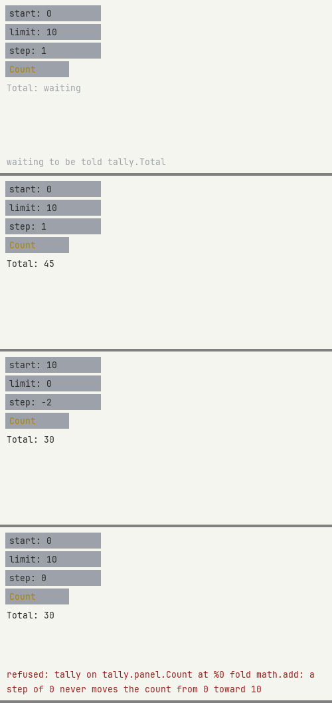

# Apps

**An app is a view and the flow that answers it, made in Workshop and run on its own: `zengine-app`
opens its window, draws its view there, takes its keys and presses, and runs its flow, with no
Workshop running.** What may run in it is decided at its own console, in Loom's `authority`
words, and kept in the app's folder.

## Pages

- [Running an app on its own](docs/app.md): an app's folder, making one in Workshop, `app.json`,
  starting it, its console, and what runs the view and the flow.

## Parts

| file | what it holds |
|---|---|
| `main.cpp` | `zengine-app`, the program: an app's folder, the artifact directory, and the console's loop of turns and lines |
| `host.hpp` | `app::AppHost`, the app host: what the program composes over its bus, the weaver seat, the role that says where the app is, the close, and the console's words |
| `weave.cpp` | `zengine-app-weave`, role `zengine.app`, the app's own weave: runs its flows, then its views, and arranges its window |
| `files.hpp` | reading `app.json`, through the compat codec, and the app's files, each bounded |
| `folder.hpp` | an app's folder written from a saved view and its flow, everything judged first: the View Builder's Export app |
| `program.hpp` | where the running program stands, and `zengine-app` beside it |
| `session_file.hpp` | `app-session.json`: the host's process id in the app's folder while it runs |
| `vocabulary.hpp` | the roles `zengine.app` and `zengine.app.host`, the ask and answer that say where the app is (`AppPlaceAsked`, `AppPlaceSaid`), and `app.json`'s shapes (`ZengineAppFile`) |
| `CMakeLists.txt` | `zengine-app-vocabulary`, `zengine-app-folder` and `zengine-app-host` (header-only), `zengine-app` and `zengine-app-weave`, and the artifacts staged beside the program |
| `docs/` | the page above and its pictures |

An app written by hand: [`examples/tally-app/`](../examples/tally-app/README.md).

## Working on it

The repository's guide is [CONTRIBUTING.md](../CONTRIBUTING.md); this section is what a change in
`app/` adds to it.

**Law.** The folder has no numbered law: what an app is, its console and its end are
[the reference's](docs/app.md), and a rule about one declaration is in that declaration's comment.
What the host must never become:

- **More than what a weave cannot hold.** `zengine-app` holds the bus, one operator catalog, the
  Kernel and its control door, the plan's booter and executor, the Flow host and the view host,
  the role that says where the app is (`zengine.app.host`), the close and the console, and nothing
  else; it never holds `zengine.workshop`. Everything an app does past that is a weave, its own
  weave among them ([write Loom, not host code](../CONTRIBUTING.md#what-a-change-is-judged-against)).
- **A second store of decisions.** The decisions are Loom's authority store in the app's folder,
  `app-authority.json`, its lock held for the run, and nothing is admitted by default. The Kernel
  asks the store at `Open`, and the plan's executor asks the same policy before each row, a
  provider's row included. Loom's warden adopts each load inside the control door, so `authority
  allow`, `show` and `revoke` reach a row that already runs.

**Suites.** Each runs through the official lane, `tests/verify.cmake`.

| suite | what it proves | where |
|---|---|---|
| `app_host` | the plan walked under the console, the window, and the close | `tests/test_app_host.cpp` |

Two shared suites hold cases of its own: the view host's, `view` (`tests/test_view.cpp`, a view
taking its window's keys), and the View Builder's, `view_builder` (`tests/test_view_builder.cpp`,
Export app writing an app's folder). The installed-package witness, `tests/package/run.cmake`, which
is no CTest entry, starts the installed `zengine-app` and decides its rows at its console.

**The host's side.**

- The plan's owner and its codec are the realization library's, header-only and installed:
  `realization/owner.hpp` and `realization/load_persist.hpp` (`zengine-realization`).
- The Flow host and the view host are composed as Workshop composes them:
  `flow/flow-host/runtime.hpp`, `view/host.hpp`.
- The decisions, the warden and the `authority` command are Loom's installed `loom::host-policy`.
- An app's folder is written by `folder.hpp` alone, which the View Builder's Export app
  (`view/view-builder/pane.cpp`) calls; it writes no decision, starts nothing, copies no artifact,
  and leaves `app-authority.json`, `app-session.json` and every other file in the folder as they
  are.
- `app-session.json` is a fact for the launcher's listing (`launcher/catalog.hpp`), which asks the
  system whether the process it names still runs; nothing in the host reads it.
- What Workshop writes or starts for an app names the program beside the one running
  (`program.hpp`).
- The root `CMakeLists.txt` adds this folder after `workshop/`, and `examples/tally-app/` after it.
  `zengine-app` and `zengine-app-weave` are installed (`cmake/ZengineInstall.cmake`), and in a
  build they are staged beside Workshop too (`workshop/CMakeLists.txt`), where the Export app names
  `zengine-app` in an app's launchers.
