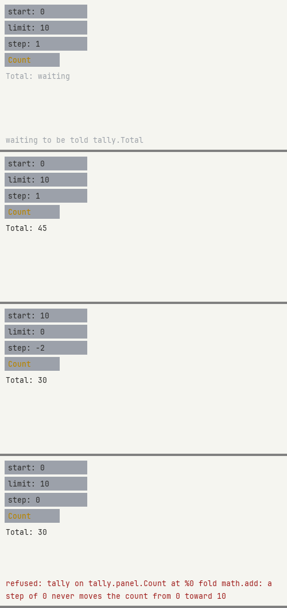

# Running an app on its own

**Reference.** An app is a view and the flow that answers it, made in Workshop, run by a small
host of its own with no Workshop running: `zengine-app`. It opens a window, draws the view there,
takes your keys and presses there, and its flow answers. What may run in it is decided at its own
console, in Loom's `authority` words, and kept in its own folder.

## An app's folder

An app is a folder of data, and nothing built:

| file | what it is |
|---|---|
| `app-plan.json` | the load plan: which artifacts run, in order, in Workshop's [load-plan format](../../workshop/docs/load-plan.md) |
| `app.json` | the app: its name, its window's skin, the views it runs and where each stands, and the flows |
| `<name>.view` | a view, as the View Builder saves it |
| `<name>.flow` | a flow, its definition and its state, as Flow's Export writes it |
| `run.cmd`, `run.sh` | the launchers: each starts `zengine-app` on the folder it stands in |
| `app-authority.json` | written by `zengine-app` as you decide: Loom's authority store |

The plan names artifacts by stem, and `zengine-app` opens each from its own artifact directory:
beside the program where a build stages them, and in an installed package the package's artifact
directory. The folder carries no artifact, so it moves whole.

[`examples/tally-app/`](../../examples/tally-app/README.md) is one: the tally panel and the tally
flow. A build stages a copy of it beside `zengine-app`, in `apps/tally/`, with `run.cmd` and
`run.sh`, each starting that program on the folder it stands in.

### Making one in Workshop

The View Builder's **Export app** writes one from the view you saved
([`view.export`](../../view/docs/zengine.view.builder.md#viewexport)): save the view as
`tally.view`, export its flow from Flow as `tally.flow` beside it, and press `[Export app]`. It
asks Workshop to allow the write, as Save does, then writes `apps/tally/` in the project:

- `app-plan.json`, through the load plan's codec: the basic operators, `zengine-app-weave`, the
  graphics directory, the OS window and the Timer, the plan
  [`examples/tally-app/`](../../examples/tally-app/README.md) holds, byte for byte;
- `app.json`, naming the app and its window after the view's file, its window sized to hold the
  view at (8, 8) and its notice rows, the `day` skin, the view in a session named after it and the
  flow in its definition's;
- `tally.view` and `tally.flow`, copied from the files it was made from, each read back first;
- `run.cmd` and `run.sh`, each starting the `zengine-app` beside Workshop on that folder.

It writes no decision and copies no artifact. Its last words name each artifact the app's console
will ask about on the first start. An app already there is replaced only after a second press, and
only those six files: `app-authority.json` and every other file in the folder stay.

`zengine-app` stands beside Workshop's program: a build stages it in Workshop's directory with
`zengine-app-weave`.

### `app.json`

Read as the load plan is, a Loom value in JSON, its integers written as quoted strings:

```json
{
  "zen": 1,
  "schema": "ZengineAppFile",
  "version": 1,
  "fields": {
    "name": "tally",
    "window": { "title": "tally", "width": "320", "height": "260", "skin": "day" },
    "views": [ { "file": "tally.view", "session": "tally.panel", "x": "8", "y": "8" } ],
    "flows": [ { "file": "tally.flow", "session": "tally" } ]
  }
}
```

- `window.title`, `width` and `height` name the app's window and size it, in pixels: the OS window
  takes them, keeping a size within its display, and a side of 0 keeps its own; the terminal window
  keeps the terminal's. `window.skin` is the painter the window paints the app's areas with: `day`
  or `night` in an OS window, `classic` or `block` in the terminal window.
- Each view runs in its own session, its area at `x`, `y` in the window's pixels, its size the
  view's own and its notice rows beneath. Each flow runs in its own session. At most eight of each.
- A file is a plain name in the app's folder; a path is refused.

## Starting it

```sh
zengine-app <app folder>
```

It says where the app is, its plan, its decisions and where it opens artifacts, then walks the plan
in order. Each row asks the decisions first, a provider's row as much as a weave's: a row with no
standing decision, or whose file is not the build that was decided, waits, and nothing of it is
opened. The console says which row waits, in the decisions' own words: the build it saw, and
the line that answers it, which you type at the console:

```text
zengine-app - waiting on this console: zengine-operators-basic
  no standing decision for 'zengine-operators-basic' (build b62140ce, <artifacts>/zengine-operators-
basic.dll); approve it at the console with:  authority trust zengine-operators-basic
authority trust zengine-operators-basic
  'zengine-operators-basic' may run; a rebuild of it will ask again. It may still say nothing until
you allow something.
zengine-app - running: zengine-operators-basic (provider 'zengine.operators.basic' supplied 5)
zengine-app - waiting on this console: zengine-app-weave
```

The second sentence of Loom's answer is the store's baseline; a row of the plan speaks with the
plan's posture, below.

The walk goes on from there to the next row the console has not decided. Once every row runs, it
says `running`. A second start whose builds have not changed asks nothing; a rebuilt artifact is
asked about again.

A row of the plan, once it runs, may say anything to anyone: the plan's posture, said at the start.
Anything else loaded in the app may say only what the console allows (`authority allow`).

### The console

| line | what it does |
|---|---|
| `authority ...` | Loom's own command over `app-authority.json`: `trust`, `deny`, `allow`, `show`, `pending`, `revoke` and the rest, as `help` lists them |
| `status` | each row of the plan, and whether it runs, waits on the console, or was refused |
| `help` | the lines above |
| `quit` | ends the app |

The console holds the decisions for as long as the app runs: a second `zengine-app` on the same
folder is refused while the first runs.

### Ending it

Closing the app's window ends it, exit 0, and so does `quit`. A close said by any other window, or
by anything that is not a window, ends nothing. The app's window is the first window that offers
itself, and the one the app's weave arranges.

Other exits: 2, the folder is not one; 3, its plan or its decisions could not be read, or another
`zengine-app` runs it; 4, a row the console had decided was refused as it loaded; 5, the console's
input ended while the plan still waited on it, as when Workshop starts an app on POSIX, with no
console, before its rows were decided ([the launcher](../../launcher/docs/zengine.launcher.md)).

## What runs the view and the flow

`zengine-app` composes the [Flow host](../../flow/docs/zengine.flow.host.md) and the
[view host](../../view/docs/zengine.view.host.md) as Workshop does. The app's own weave,
`zengine-app-weave` in the office `zengine.app`, is a row of the plan like any other:

- it asks the host where the app's folder is (`zengine.app.host`), reads `app.json`, and runs each
  flow, then each view, in its own session, as its office;
- on the graphics directory's start and the window's offer, it offers the skin `app.json` names
  from the host's artifact directory, places each view's area where `app.json` says, hearing the
  window's keys, and chooses the skin; once its own line has its room in a window it says that
  window's title and size from `app.json`, once each time the window starts, and places its line
  at the foot of each size the window offers;
- when something went wrong -- `app.json`, a file, a refused run -- it says so on a line of its own
  at the window's foot.

A view placed to hear its window's keys takes them, and their text, from the window that shows its
area: Tab moves between its number fields, keys edit the one in focus, and a press on a button
uses it. Its notice rows say what it said and what was refused, the flow's refusals among them.



Order the plan's rows as the probe does: the providers first, so a flow's operators resolve when it
runs; then the app's weave, so it hears the directory's and the window's offers; then the
directory and the window; and the Timer last, whose loading starts time.
