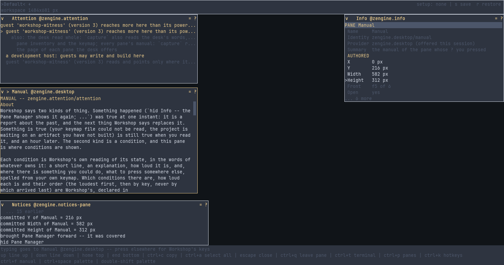

# Attention

**A Workshop pane that shows what is true right now and worth your attention: a keymap file
that could not be read, an update from a pane that Workshop could not keep, a pane of yours that
is off the screen. You place it on your desk like any other pane, and a condition goes away only
when it stops being true.**

Its first row is the glance: the most serious condition and a count of the rest. Below it, every
condition in its owner's own words. You can hide one from the list; hiding changes nothing about
what is true.

## Pages

- [`zengine.attention`](docs/zengine.attention.md): the pane's manual -- what it shows, its keys,
  and hiding a condition
- [What earns attention](docs/conditions.md): every condition Workshop says here, and how loud
- [The laws of attention](docs/attention-laws.md): a condition and an utterance kept apart, how
  conditions are ranked, and what hiding one changes

## Parts

| file | what it holds |
|---|---|
| `pane.cpp` | the pane, `zengine-attention-pane`: offers the one `attention` pane, hears `StandingConditions`, says its rows and answers its manual |
| `vocabulary.hpp` | the role `zengine.attention`, the pane key, the stem, the action ids your keymap file can move, its one setting, and `AttentionPaneState`, what a reload keeps |
| `CMakeLists.txt` | the loadable weave, its manual compiled in; it needs a Loom that can host loadable weaves (`loom::kernel`) |
| `docs/` | these pages |

## Working on it

The repository's guide is [CONTRIBUTING.md](../CONTRIBUTING.md); this section is what a change in
`attention/` adds to it.

**Law.** Seven numbered laws, on [the laws of attention](docs/attention-laws.md): an utterance and
a condition are two surfaces (WL-ATTN-01); `attention_conditions` is a pure projection (WL-ATTN-03);
a derived condition stays derived (WL-ATTN-04); ranking is `ranks_before` alone (WL-ATTN-07); hiding
is the pane's, scoped to the statement (WL-ATTN-08); a condition names an action and holds no power
(WL-ATTN-10); and the condition path holds no timer, callback or history (WL-ATTN-11). Their proofs
are listed in `tests/laws/attention.txt`. Most of them bind Workshop's side, where the conditions
are held and ranked.

**Suites.** The folder has no suite of its own; its cases stand in suites other routers claim,
each run through the official lane, `tests/verify.cmake`. `workshop_panes_inspect`
(`tests/test_workshop_panes_attention.cpp`) runs the loaded pane against what Workshop really
publishes; `graphics` (`tests/test_graphics.cpp`) draws, presses and reloads it in a window; and the
conditions it shows are Workshop's, proven in `workshop_host` (`tests/test_workshop_host.cpp`). The
rig in `tests/workshop_support.hpp` finds the pane by its stem (`WORKSHOP_SO_ATTENTION_PANE`); its
stem and `attention/pane.cpp` are also a sample artifact and source in `workshop_load`
(`tests/test_workshop_load.cpp`) and `workshop_files` (`tests/test_workshop_files.cpp`).

**The host's side.**

- Workshop's plan, `workshop/default-load-plan.json`, loads it as an optional row for the role
  `zengine.attention`; `workshop/CMakeLists.txt` stages it beside the host and lists it as a
  development pane.
- What it hears is `workshop/attention_seam_vocabulary.hpp` (`StandingConditions`,
  `attention_glance`). Workshop's grant to say it is in `workshop/grant.cpp`, and
  `workshop/guests.cpp` counts it as the desk a guest reads with `capture`.
- The conditions are held in `workshop/attention.hpp` and `workshop/screen_attention.cpp`, and
  `WorkshopWeave::say_conditions` (`workshop/weave_run.cpp`) publishes them.
- The pane protocol it speaks is `pane/vocabulary.hpp`, with `pane/text.hpp`, `pane/parts.hpp` and
  `pane/menu.hpp`; its facets are `pane/facets.hpp` with `pane/drawing.hpp`, and the drawing it
  makes is `graphics/vocabulary.hpp`'s.
- Good practice here is [Attention](../docs/contributing/best-practices.md#attention-attention) in
  the best practices.
