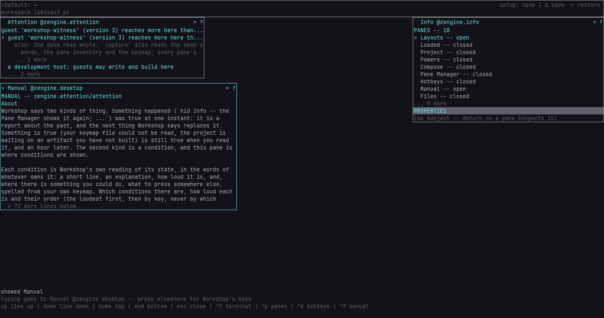

# Attention

**A Workshop pane that shows what is true right now and worth your attention: a keymap file
that could not be read, an update from a pane that Workshop could not keep, a pane of yours that
is off the screen. You place it on your desk like any other pane, and a condition goes away only
when it stops being true.**

Its first row is the glance: the most serious condition and a count of the rest. Below it, every
condition in its owner's own words. You can hide one from the list; hiding changes nothing about
what is true.

## Pages

- [`zengine.attention`](docs/zengine.attention.md): the pane's manual -- what it shows, its keys,
  and hiding a condition
- [What earns attention](docs/conditions.md): every condition Workshop says here, and how loud

## What is in this folder

| | |
|---|---|
| `pane.cpp` | the pane itself, built as a weave Workshop loads (`zengine-attention-pane`) |
| `vocabulary.hpp` | the names it is known by (`zengine.attention`), the actions your keymap file can move, and what it keeps when reloaded |
| `CMakeLists.txt` | how the pane is built |
| `docs/` | these pages |

Working on it: [AGENTS.md](AGENTS.md).
