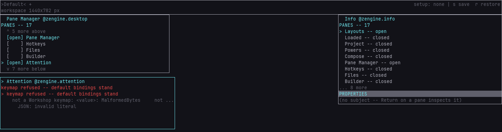

# What earns attention

**Reference.** The conditions Workshop holds true and says to the Attention pane, and how loud each
is. The pane itself, its keys and its rows, is [its manual](zengine.attention.md).

**Workshop as a product.** Workshop says two different kinds of thing out loud, and telling
them apart is the whole of this page:

| | |
|---|---|
| **something happened** | `committed Width of Layouts = 12 cells`, `hid Info -- …`, `released #12`. It was true at one instant and it is a report about the past. It goes on the **notice row** in the bottom band, and the next thing Workshop says replaces it. |
| **something is true** | your keymap file could not be read; a pane you authored is off the screen; the project is waiting on an artifact you have not built. It is still true when you read it, and it is still true an hour later. It goes to **attention**. |

The difference matters because the two need opposite lifetimes. A report about the past is
finished the moment it is said; a standing truth has to disappear **when it stops being true**
and at no other moment. A sentence somebody said once cannot do that.

## The conditions

| condition | how loud |
|---|---|
| your keymap file exists and could not be read — the default bindings stand | an alert |
| your preferences file exists and could not be read — Workshop will not overwrite it | an alert |
| an older local keymap or session file is being shadowed by the one under your user directory | worth acting on, not urgent |
| a pane sent Workshop an update it could not keep -- rows or a picture; the pane says so where it shows, and a picture it drew before stays, marked `(update refused)` | an alert |
| a tool your load plan marks optional could not be loaded this run — named by its artifact, `zengine-files is not in this Workshop`, with the loader's own reason and what to do: build it, then launch again | an alert |
| a pane you authored is resolvable and **no part of it is on the screen** — its place is off the canvas | worth acting on |
| the project is stopped at an artifact waiting to be built | informative — waiting is not a failure |
| the guests file names this Workshop a development host: a guest's hand writes files, types into panes and reaches the editor and the Terminal here, as yours does ([the external host](../../external-host/README.md)) | worth acting on, not urgent |
| a guests-file row whose powers do not all reach here, with its version and what does not: no `build`, or what a weaver's host refuses a guest | worth acting on, not urgent |
| a guests-file row whose powers reach more here than their names once did, with its version and what more: `capture` reads the desk said whole, the pane inventory and the keymap ([the external host](../../external-host/README.md)) | worth acting on, not urgent |

Some true things are deliberately **not** here. A pane you hid is your own choice and lives
in the Pane Manager. A pane the
setup names that this run cannot resolve is already counted on Workshop's first row, all day. A pane that is behind another one is still on the screen,
and stacking is what arranging *is*. Attention is for what you would otherwise not find out.
