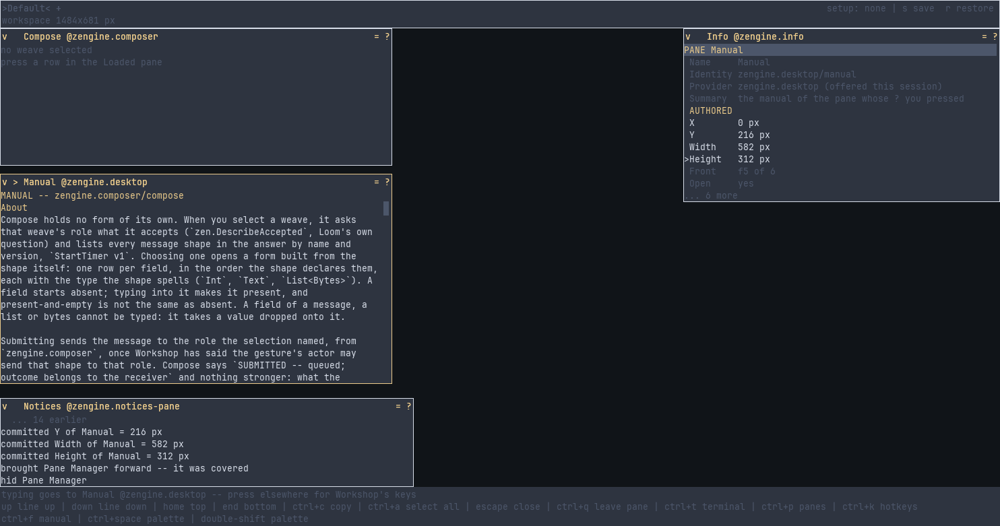

# Compose

**Compose is the Workshop pane in which you write a message and send it to a running weave.
Select a weave in the Loaded pane, and Compose asks it which messages it accepts; pick one,
fill in its fields and submit it.**

The form is built from the message shapes the weave itself reports, so nobody has to write a
form for a weave before it can be spoken to, and a value that does not fit its field is refused
with a sentence naming the field and the kind of value it takes. A finished command, or an
unfinished preset, can be kept in Inventory and dropped back onto Compose later; a drop fills
the form, and only Submit sends it.

## Pages

- [`zengine.composer`](docs/zengine.composer.md): the manual -- every command, what Compose hears
  and what its rows show
- [Reuse a stored command through Compose](../inventory/docs/inventory-compose.md): choose a
  message, fill it, store it, bring it back and send it, step by step
- [Panes](../workshop/docs/panes.md): how Compose and every other pane is shown, moved and sized
- [The Loaded pane](../introspection/docs/zengine.introspection.md#loaded): where the weave Compose writes to
  is chosen
- [Reusable message and value drafts](../message-draft/docs/message-drafts.md): the typed
  values and presets Compose's fields are made of

## Parts

| file | what it holds |
|---|---|
| `composer.cpp` | the Compose pane, `zengine-composer`, a weave Workshop loads |
| `draft.hpp` | a message being written, its fields and what they compose to; in `zengine-composer-draft`, which needs no bus |
| `view.hpp` | what the pane shows, row by row, and what each row stands for; in `zengine-composer-draft` too |
| `vocabulary.hpp` | the pane's lasting names: its role `zengine.composer`, its pane `compose` and its library stem; `zengine-composer-vocabulary`, which links nothing |
| `command_context.hpp` | `ComposerCommandContext` v1, the note kept beside a stored command: which role it was written for |
| `docs/zengine.composer.md` | the manual, which the weave carries and answers |
| `CMakeLists.txt` | the three targets; the weave is skipped where Loom exports no `loom::kernel` |

Compose is part of Workshop, not of the installed library, so its headers are not installed.

## Working on it

The repository's guide is [CONTRIBUTING.md](../CONTRIBUTING.md); this section is what a change in
`composer/` adds to it.

**Law.** Compose keeps the pane seam's law, in its section "The Composer is a schema-directed
message form" ([the pane seam](../agents/panes.md)), and its drafts keep
[the message drafts' law](../agents/message-drafts.md), which `message-draft/`'s router routes. A
rule about one declaration is in that declaration's comment.

**The manual is compiled in.** `zengine-composer` carries `docs/zengine.composer.md` and answers it
when asked, so an edit to the manual is a build: its manual witnesses, in `workshop_panes_hand`,
hold its commands to the actions the pane declares, and the `manual` check holds its form.

**Suites.** Each runs through the official lane, `tests/verify.cmake`.

| suite | what it proves | where |
|---|---|---|
| `composer` | drafts and views as values: what composes, what is refused and why, and what shows | `tests/test_composer.cpp` |

Its cases in shared suites: `workshop_panes_hand` (`tests/test_workshop_panes_input.cpp`, with its
action census driver, `tests/actions/zengine.composer.txt`, and its manual witnesses),
`workshop_panes_info` (`tests/test_workshop_inventory_info.cpp`), `workshop_document`
(`tests/test_workshop_document.cpp`), `workshop_shapes` (`tests/census_headers.hpp`) and
`workshop_files` (`tests/test_workshop_files.cpp`, its development catalog row).

**The host's side.**

- Loading: the optional `zengine.composer` row in `workshop/default-load-plan.json`;
  `workshop/CMakeLists.txt` stages the weave and lists it among the development setup's pane
  weaves.
- The seam: Compose has no seam vocabulary of its own. It speaks the pane protocol,
  `pane/vocabulary.hpp`, and the pane parts it includes (`pane/parts.hpp`, `pane/menu.hpp`,
  `pane/carry.hpp` and others).
- Submitting: a `PaneOperationRequested` (`pane/operation.hpp`), which Workshop judges for the
  gesture's actor in `workshop/weave_operation.cpp`, with `workshop/actor_scope.hpp`.
- Grants: `workshop/guests.cpp` lets a guest with the `demo` power reset the pane.
- The owners it asks: the target role (`zen.DescribeAccepted`), Introspection (`LoadedSelected`,
  `introspection/vocabulary.hpp`), the window's clipboard and Inventory
  (`inventory/pane_client.hpp`).

**Practice.** [Compose](../docs/contributing/best-practices.md#compose-composer-message-draft).
