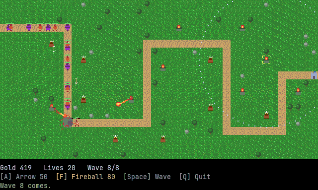
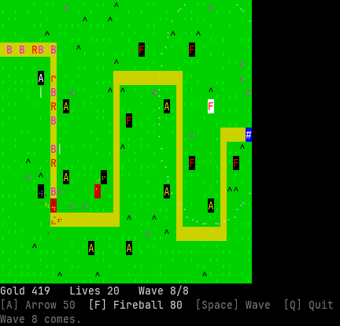

# Tile defense — a game drawn in both windows

**Reference / example.** A tower defense on a map of
<!-- value tile_defense::kCols -->40<!-- /value --> by <!-- value tile_defense::kRows -->20<!-- /value -->
tiles: walkers come down a road in waves, and arrow towers and fireball towers stop them before
they reach the castle. One game's code draws it; the GUI window shows it in pixels,
<!-- value tile_defense::kTileWantPx -->16<!-- /value --> to a tile, and the terminal in characters,
a cell to a tile. The game never asks which window shows it: it says what it draws -- a sheet, the
map's tiles, sprites and points -- and each window shows that its own way.





Both are the last wave, the busiest, taken by the bench (below): the GUI window as SDL drew it, and
the terminal drawn from the bytes the TUI window wrote it, in xterm's colours.

## Run it

From a build tree, beside its program (`examples/tile-defense/` in the build):

```sh
zengine-tile-defense          # in a GUI window of its own
zengine-tile-defense --tui    # in the terminal it was started from, at least 80 by 24
```

A build without SDL (`ZENGINE_TUI_ONLY`) has no GUI window: run it with `--tui`. Closing the GUI
window, or `q` in either, ends the game.

## Play it

- Your gold builds towers off the road: **A** chooses the arrow tower and **F** the fireball tower,
  each at the price the words beneath the board say. Click a tile to build there, or move the
  cursor with the arrow keys and press **Return** (or **B**).
- **Space** (or **N**) sends the next wave. <!-- value tile_defense::kWaves -->8<!-- /value -->
  waves held hold the castle; a walker that reaches it takes a life (a brute takes two), and
  <!-- value tile_defense::kStartLives -->20<!-- /value --> lives lost lose it. **R** starts again once the game
  is over; **P** pauses.
- An arrow tower draws its bow as it nears its shot and looses arrows that point the way they
  fly; a fireball tower's brazier burns, flares as it throws, and its fireball trails sparks and
  bursts on what it strikes, hurting everything near. Both reach far, so their shots are watched.
- The ring of dots is the reach of the tower under the cursor, or of the one you would build.
- The words beneath the board are pressable too: `[A] Arrow`, `[F] Fireball`, `[Space] Wave`,
  `[Q] Quit`.

## How it is made

| file | what it is |
|---|---|
| [`vocabulary.hpp`](vocabulary.hpp) | its roles, its area, the world it keeps (`TileWorld`), its quit and its step |
| [`rules.hpp`](rules.hpp) | the rules, pure: the road, waves, walkers, towers, shots, sparks, gold and lives |
| [`art.hpp`](art.hpp) | the sheet, made in its own code at its start: each frame's pixels and its character |
| [`picture.hpp`](picture.hpp) | the picture, pure: the world drawn whole, a layer a node |
| [`stage.cpp`](stage.cpp) | `tile-defense-stage`, its arranger: the first window that offers itself, its palette and size |
| [`game.hpp`](game.hpp), [`game.cpp`](game.cpp) | the game's weave, and `tile-defense`, the library it is loaded from |
| [`play.cpp`](play.cpp) | `zengine-tile-defense`, the host: its boot list and its loop's rest, nothing else |
| [`bench.cpp`](bench.cpp) | `zengine-tile-defense-bench`: the game played to its busiest wave through each window, and what a picture costs |

How the drawing works -- sheets, tiles, sprites and points, layers, and a tile's size in each
window -- is [the Graphics package](../../graphics/docs/graphics.md). The `tile_defense` suite
plays a wave headless through both windows' painting (`tests/test_tile_defense.cpp`).

## Measure it

```sh
zengine-tile-defense-bench                       # both windows, one after the other
zengine-tile-defense-bench --pictures <folder>   # ...and pictures of each, mid-wave, as BMPs
```

The bench plays the game itself: it builds towers as its gold allows and sends each wave once the
last is held, with each window mounted in the bench's own process -- the GUI window over SDL's
backend, its window kept behind the others, and the TUI window over a terminal that keeps its bytes.
Through the last wave, the busiest, it times each step of the world from its beat to its picture
shown, and says for each window the median and the 95th percentile, the bytes of the drawings Loom
carried, the showings and their bytes, the textures made once steady, and the nodes in the game's
area. A build in Release measures what a player sees; a Debug build runs it to check it still plays.