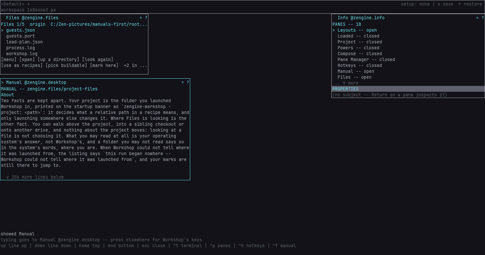

# Files

**Files is the Workshop pane for browsing your computer. It starts in the folder you launched
Workshop in and can go anywhere you are allowed to read; you can mark places you keep coming
back to, open a file in the Editor, pick the file that holds your build recipes, and write a new
recipe for something in the folder you are looking at.**

It is not a file manager: it does not rename, delete or copy anything. It arrives as a separate
loadable piece that Workshop loads at startup, not as part of Workshop itself.

## Pages

- [`zengine.files`](docs/zengine.files.md): the manual -- how to open the pane, every command and
  row, the marks and the file they are kept in

## What is in this folder

| | |
|---|---|
| `files.cpp` | the pane itself |
| `vocabulary.hpp` | the names a saved setup or a keymap uses for this pane and its actions |
| `files.hpp` | how a folder is listed |
| `marks.hpp`, `marks_persist.hpp` | your marked places, and the file they are kept in |
| `filesystem_roots.hpp`, `os.cpp` | what it asks the operating system: its drives, and which folders are links |
| `CMakeLists.txt` | how the pane is built |
| `docs/` | these pages |

Working on it: [AGENTS.md](AGENTS.md).
