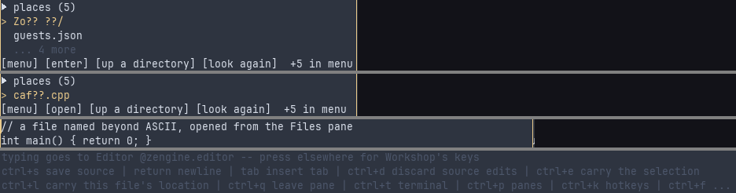

# zengine.files -- Files

**Manual.** The pane you browse your computer with. It starts in the folder you launched Workshop
in and goes anywhere your system lets Workshop read. It opens a file in the Editor, keeps the places
you mark, hands a file to the Builder as your recipe file, and writes a new recipe for something in
the folder you are looking at. It is a *weave*: a piece of Workshop that is loaded, replaced and
spoken to by messages, built as `zengine-files` and loaded at startup by a row of the load plan.
Other weaves reach it by its *office*, the name it answers to, `zengine.files`; its one pane is
`zengine.files/project-files`, the name a saved desk and a keymap file use.

## About

Two facts are kept apart. Your *project* is the folder you launched Workshop in, printed on the
startup banner as `zengine-workshop - project: <path>`: it decides what a relative path in a recipe
means, and only launching somewhere else changes it. Where Files is *looking* is the other fact. You
can walk above the project, into a sibling checkout or onto another drive, and nothing about the
project moves: looking at a file is not choosing it. What you may read at all is your operating
system's answer, not Workshop's, and a folder you may not read says so in the system's words, where
you are. When Workshop could not tell where it was launched from, the listing says `this run began
nowhere -- Workshop could not tell where it was launched from`, and your marks are still there to
jump to.

A listing is everything there, dot-files, `.git` and build folders too: folders first, then files,
each group in the order of its names' bytes, the same on every machine. There is no `..` row. A
folder that is a link (on Windows, any reparse point, a junction too) is listed `(link)` and can be
entered; going up from inside it returns to the folder you walked in from. A listing is taken when
Workshop gives the pane its room, when you walk somewhere, when you press
[`files.refresh`](#filesrefresh), and when a build ends. Nothing watches the disk.

Each layout keeps two settings for the pane: `wheel-rows`, pinned, the rows a wheel notch moves,
and `listed-entries`, the entries a listing holds before its header says `stopped counting`. A
value one cannot use keeps its default and is said to Workshop.

Files is not a file manager: it renames, deletes, copies and creates nothing, has no search and no
filter, and judges no file's contents. What a row knows is a name and whether it is a folder.
[`files.use-recipes`](#filesuse-recipes) hands over a path and
[`files.pick-buildable`](#filespick-buildable) a place; the owner that reads them judges them.

## Use

Open it from the Pane Manager, <!-- key desktop.panes -->`ctrl+p`<!-- /key -->: move to **Files**
and press Return. Its keys act only while it holds your keys: press into it first. Escape while you
browse gives your keys back to Workshop. Walk with [`files.up`](#filesup), [`files.down`](#filesdown),
[`files.open`](#filesopen) and [`files.parent`](#filesparent), and jump between the places you keep
with [`files.next-mark`](#filesnext-mark). A desk saved naming `zengine.workshop/project-files`
opens this pane.

Each command is also a control in the strip below the rows, and a line in the pane's menu
([`files.menu`](#filesmenu)). A control that cannot act now is drawn in round brackets, `(use as
recipes)`, and still answers, with its reason. A press on a control acts; a press on a row selects
it, and on the row already selected acts on it, but only while your keys were already in Files. A
press aimed at rows that moved before it arrived is refused, `the rows moved -- press again`.

Opening a file, choosing the recipe file, marking a place and writing a recipe each ask Workshop
first, as an `open` or a `write`. A refusal names what was not done and why: `` `alpha.cpp` was not
opened -- <Workshop's reason> ``, `the recipes in force are unchanged -- ...`, `nothing was marked --
...` (`no mark was forgotten -- ...`), `no recipe was written -- ...`; or, before Workshop answered,
`... -- <n> acts are already waiting on Workshop`, `... -- Workshop could not be asked`, or `... --
Workshop could not be asked (<the bus's reason>)`.

Return has an id of its own in each step, [`files.open`](#filesopen),
[`files.choose`](#fileschoose) and [`files.commit-field`](#filescommit-field), and a keymap file
moves each alone. A keymap that also puts `files.up`, `files.down` or `files.cancel` on `return`
collides with a step's own Return when that step opens: Workshop refuses that step's keys, naming
both, and Escape and Return do nothing there until you move one in your file and start Workshop
again.

## Commands

### `files.up`

Moves the cursor up one row. In the chooser it moves through the candidates; on the recipe fields it
stands the line on the field above, keeping what the field you leave holds.

- **Takes:** the list in force. Default key <!-- key files.up -->`up`<!-- /key -->; the wheel moves
  the cursor too, except on the recipe fields.
- **Answers:** the `>` moves, and the header counts it, `Files 3/24`. The list scrolls only when the
  cursor would leave it, so the rows stay under your hand.
- **Refuses:** nothing; at the first row nothing moves.
- **Example:** <!-- key files.up -->`up`<!-- /key -->.

### `files.down`

Moves the cursor down one row; in the chooser, to the next candidate; on the recipe fields, to the
field below.

- **Takes:** the list in force. Default key <!-- key files.down -->`down`<!-- /key -->.
- **Answers:** the `>` moves, and the header counts it.
- **Refuses:** nothing; at the last row nothing moves.
- **Example:** <!-- key files.down -->`down`<!-- /key -->.

### `files.open`

Enters the folder under the cursor, or opens the file under it in the Editor. A name beyond ASCII
opens like any other.

- **Takes:** the selected row. Default key <!-- key files.open -->`return`<!-- /key -->; the
  control `[enter]` or `[open]`; a press on the selected row while Files holds your keys.
- **Answers:** a folder: its listing, and `in <path>`, with `(origin)`, `(marked)` or `(filesystem
  root)` when the place is one. A file: asked of Workshop as an `open` of its path, then sent to the
  opening office, `zengine.opening`
  ([`OpenSourceRequested`](../../workshop/docs/zengine.opening.md#opensourcerequested)). The Editor
  shows it and takes your keys, and Files says nothing. The Editor judges the file: one it cannot
  edit is refused in its words, which Files shows on its first row.
- **Refuses:** `no row is selected -- nothing was opened`; `` `name` has bytes this Workshop cannot
  carry in a path -- it cannot be opened ``; `this run began nowhere -- there is no location to act
  in`; `` `name` cannot be reached from here ``; `` `name` was not opened -- nothing was queued to the
  opening office ``; `` `name` was not opened -- the open could not reach zengine.opening (<the bus's
  reason>) ``; the opening office's own words, as when no Editor is loaded or it holds unsaved edits;
  and the refusals every act shares ([Use](#use)).
- **Example:** move to `alpha.cpp`, press <!-- key files.open -->`return`<!-- /key -->.

### `files.parent`

Goes up one folder, the cursor on the folder you came out of.

- **Takes:** where you are. Default key <!-- key files.parent -->`backspace`<!-- /key -->; the
  control `[up a directory]`.
- **Answers:** the listing above, and `in <path>`.
- **Refuses:** `/ is the top of this filesystem`, at `/` or a drive root; `there is nowhere to go up
  from -- this run began nowhere`.
- **Example:** <!-- key files.parent -->`backspace`<!-- /key -->.

### `files.refresh`

Lists where you are again, the cursor back on the first row.

- **Takes:** where you are. Default key <!-- key files.refresh -->`r`<!-- /key -->; the control
  `[look again]`.
- **Answers:** `listed /home/you/game again`.
- **Refuses:** nothing; a folder that cannot be listed says why where its rows would be, `cannot
  list <path>: <the system's reason>`.
- **Example:** after another program wrote a file here, press
  <!-- key files.refresh -->`r`<!-- /key -->.

### `files.use-recipes`

Makes the file under the cursor the recipe file the Builder builds from, until Workshop quits.
Nothing judges the file by its name: the project office reads it, and answers
([choosing another recipe file](../../builder/docs/recipes.md#choosing-another-recipe-file-while-workshop-runs)).

- **Takes:** the selected file. Default key <!-- key files.use-recipes -->`u`<!-- /key -->; the
  control `[use as recipes]`.
- **Answers:** asked of Workshop as a `write`, then sent to the project office, `zengine.project`
  ([`RecipeUseRequested`](../../workshop/docs/zengine.project.md#recipeuserequested)). Its answer is
  the notice, `build recipes: recipes.json (3 recipes) in /home/you/game`, and Files then asks the
  Builder to say its recipes again
  ([`StatusRequested`](../../builder/docs/zengine.builder.md#statusrequested)), so the Builder pane
  shows them.
- **Refuses:** `` `src` is a directory -- a recipe catalog is one authored file ``; `no row is
  selected -- the recipes in force are unchanged`; a name Workshop cannot carry, `... -- the recipes
  in force are unchanged`; `this run began nowhere -- the recipes in force are unchanged`; the
  office's refusal, `not a recipe catalog -- the recipes in force are unchanged: <its reason>; still
  using <the file in force>` (`no catalog` when none is); and the refusals every act shares.
- **Example:** on `build-recipes.json`, press <!-- key files.use-recipes -->`u`<!-- /key -->.

### `files.mark`

Marks the folder you are in, or forgets it when it is marked. A mark is a place and nothing else:
it adds nothing to your project, grants nothing and makes nothing buildable. A mark to somewhere
that is not there today, an unplugged drive, is kept.

- **Takes:** where you are. Default key <!-- key files.mark -->`m`<!-- /key -->; the control `[mark
  here]` or `[unmark here]`.
- **Answers:** asked of Workshop as a `write`; then `marked: <path>` or `no longer marked: <path>`,
  and the marks file is written at once ([Files](#files)). The header names a marked place
  `marked`.
- **Refuses:** `there is nowhere to mark -- this run began nowhere`; `could not write your marks:
  <the reason>`, the mark kept for this run; and the refusals every act shares. When the marks file
  was refused at launch, a mark lasts this run only, and the file is left as it was.
- **Example:** in a checkout you return to, press <!-- key files.mark -->`m`<!-- /key -->.

### `files.next-mark`

Goes to the next place this Workshop knows, wrapping at the end: the *origin*, where this run was
launched, never written down; your marks, in the order of their paths; and the filesystem roots,
`/`, or on Windows the drives the system lists right now (a share you can only type the name of is
not among them).

- **Takes:** where you are; the roots, asked when you press. Default key
  <!-- key files.next-mark -->`n`<!-- /key -->; the control `[next mark]`.
- **Answers:** that place's listing, and `at <path>`, with `(origin)`, `(marked)` or `(filesystem
  root)`, as many as are true: `at /home/you/game (origin, marked)`.
- **Refuses:** `there is nowhere to jump to -- no origin, no marks, and no filesystem roots`.
- **Example:** <!-- key files.next-mark -->`n`<!-- /key --> until the header says `marked`.

### `files.previous-mark`

Goes to the previous place this Workshop knows, wrapping at the start. Otherwise as
[`files.next-mark`](#filesnext-mark).

- **Takes:** where you are; the roots. Default key
  <!-- key files.previous-mark -->`shift+n`<!-- /key -->; the control `[previous mark]`.
- **Answers:** that place's listing, and `at <path>`, as [`files.next-mark`](#filesnext-mark).
- **Refuses:** as [`files.next-mark`](#filesnext-mark).
- **Example:** <!-- key files.previous-mark -->`shift+n`<!-- /key -->.

### `files.pick-buildable`

Opens the chooser: what the folder you are in can try to build, a source file (`.cpp`, `.cc` or
`.cxx`) or a folder holding a configured CMake tree, one with a `CMakeCache.txt`. A folder holding
only a `CMakeLists.txt` is not offered, and neither is a name beyond ASCII, since a recipe's line is
measured in bytes.

- **Takes:** the listing. Default key <!-- key files.pick-buildable -->`a`<!-- /key -->; the
  control `[pick buildable]`.
- **Answers:** `pick something buildable -- Return authors a recipe, Escape cancels`, and the
  candidates in the pane's own rows ([commands in the chooser](#commands-in-the-chooser)).
- **Refuses:** `nothing is listed here -- nothing to pick from`; `nothing buildable in <path> -- no
  source file, and no directory holding a configured CMake tree`.
- **Example:** in a folder holding `oven.cpp`, press
  <!-- key files.pick-buildable -->`a`<!-- /key -->.

### `files.menu`

Opens this pane's menu about what is selected: every command of the step you are in, each spelled
with what it acts on, `` open `alpha.cpp` ``, `` use `recipes.json` as this project's recipes ``,
`mark this place` or `forget this place`, and beneath them Workshop's own rows for the pane.

- **Takes:** the selected row, candidate or field. Default key
  <!-- key files.menu -->`shift+m`<!-- /key --> while you browse and in the chooser; none on the
  recipe fields, where a capital letter is typed; the control `[menu]`, always first; a right press
  on a row.
- **Answers:** the menu, presented by Workshop's menu presenter (`PaneMenuRequested`). A right press
  on what names nothing, the header or a blank, opens Workshop's menu instead. A line that begins
  typing a field takes your keys; a line that only walks takes nothing.
- **Refuses:** a line whose subject moved meanwhile, `` `alpha.cpp` is not what is here now -- aim
  again ``; `that menu was about <path> -- nothing was done`; `that field is not open any more --
  nothing was typed`; `that draft is not open any more -- nothing was typed`.
- **Example:** press <!-- key files.menu -->`shift+m`<!-- /key --> and choose `look at this
  directory again`.

## Commands in the chooser

These replace the browser's commands while the chooser is open. [`files.up`](#filesup),
[`files.down`](#filesdown) and [`files.menu`](#filesmenu) stay, about the candidates.

### `files.choose`

Takes the candidate under the cursor and opens its recipe fields, the line standing on the first.

- **Takes:** the candidate. Default key <!-- key files.choose -->`return`<!-- /key -->; the control
  `[author a recipe for this]`; a second press on the candidate under the cursor.
- **Answers:** `a source file: oven.cpp -- Return commits a field, Escape cancels`, or `a configured
  tree: build -- ...`, and the fields ([commands on the recipe fields](#commands-on-the-recipe-fields)).
- **Refuses:** a menu line about a candidate no longer under the cursor, `` `oven.cpp` is not what
  is here now -- aim again ``. With no candidate under the cursor, the chooser closes.
- **Example:** on `oven.cpp`, press <!-- key files.choose -->`return`<!-- /key -->.

### `files.cancel`

Leaves the chooser, or abandons the recipe fields whole. Nothing is written.

- **Takes:** the step you are in. Default key <!-- key files.cancel -->`escape`<!-- /key -->; the
  control `[cancel]` in the chooser, `[abandon]` on the fields.
- **Answers:** `no recipe was authored` from the chooser, `no recipe was written` from the fields;
  the listing comes back.
- **Refuses:** nothing.
- **Example:** <!-- key files.cancel -->`escape`<!-- /key -->.

## Commands on the recipe fields

These replace the chooser's commands while a recipe is being written. [`files.up`](#filesup) and
[`files.down`](#filesdown) stand the line on the field above or below, [`files.menu`](#filesmenu)
stays with no default key, and [`files.cancel`](#filescancel) abandons the draft. Every other key
goes into the line, so Backspace deletes a character.

A source asks four fields, all required: `recipe name`, `artifact stem`, `package prefix
(comma-separated)` and `link targets (comma-separated)`. A tree asks `recipe name`, `cmake target`,
`artifact stem` and `artifact directory (optional)`, and a fifth, `configuration`, only when it
builds several. The recipe name is seeded from the candidate, and the artifact stem from the recipe
name, or for a tree from its cmake target. A press on a field
row stands the line on it, keeping what each field holds. What you type is a draft: Workshop
composes the row, checks it by the recipe rules, appends it to the recipe file in force and installs
it ([adding a recipe from Files](../../builder/docs/recipes.md#adding-a-recipe-from-files)).

### `files.commit-field`

Keeps the field the line stands on and steps to the next; from the last field it writes the
recipe, as [`files.write-recipe`](#fileswrite-recipe).

- **Takes:** the field. Default key <!-- key files.commit-field -->`return`<!-- /key -->; no control
  of its own.
- **Answers:** the next field's line, `artifact stem> oven`; from the last field, as
  [`files.write-recipe`](#fileswrite-recipe): the recipe written
  ([`RecipeAuthorRequested`](../../workshop/docs/zengine.project.md#recipeauthorrequested)) and the
  Builder asked again ([`StatusRequested`](../../builder/docs/zengine.builder.md#statusrequested)).
- **Refuses:** `recipe name is required -- nothing was written`, for an empty required field.
- **Example:** type `oven`, press <!-- key files.commit-field -->`return`<!-- /key -->.

### `files.next-field`

Keeps the field and steps to the next, and nothing else: it never writes.

- **Takes:** the field. No default key; the control `[next field]`, drawn `(next field)` on the last
  field; the menu line `keep this field and type the <next field>`.
- **Answers:** the next field's line.
- **Refuses:** `<field> is required -- nothing was written`; on the last field, `` link targets
  (comma-separated) is the last field -- `write the recipe` writes the draft ``.
- **Example:** press the control `[next field]`.

### `files.write-recipe`

Writes the whole draft from whichever field you stand on.

- **Takes:** the draft. No default key; the control `[write the recipe]`, drawn `(write the
  recipe)` while a required field is empty; the menu line `` write the recipe for `oven.cpp` ``.
- **Answers:** asked of Workshop as a `write`, then sent to the project office, `zengine.project`
  ([`RecipeAuthorRequested`](../../workshop/docs/zengine.project.md#recipeauthorrequested)), and the
  fields close. Its answer is the notice, `` authored recipe `oven` -> zengine-oven in
  /home/you/game/build-recipes.json (2 recipes) ``, and Files then asks the Builder to say its
  recipes again ([`StatusRequested`](../../builder/docs/zengine.builder.md#statusrequested)).
- **Refuses:** `<field> is required -- nothing was written`, naming the first one left empty; the
  office's refusal, `no recipe was written: <its reason>; still using <the file in force>`; `that
  draft is not open any more -- no recipe was written`, when you abandoned it before Workshop
  answered; and the refusals every act shares. Refused by Workshop, the draft stays open.
- **Example:** press the control `[write the recipe]`.

## Follow

Files publishes nothing for an observer: its rows are Workshop's to show, and what it changes is
owned elsewhere. Follow those owners instead: the recipe file in force through the Builder's
`RecipeCatalog` ([Follow](../../builder/docs/zengine.builder.md#follow)), an open through the
Editor, and a mark through the marks file ([Files](#files)). Files itself hears the Builder's
`BuildStatus`, and lists the folder again when a build ends. It tells Workshop
`PaneSettingUnused` when a layout hands it a setting it cannot use.

## Shows

### `notice`

The answer to your last act, on the first row, until your next act: `in /home/you/game (origin)`.
A press on it names nothing.

### `header`

`Files`, the cursor's row and the count, why the place is known, and where it is:
`Files 3/24  origin  /home/you/game`. `Files (waiting)` until the host has said where this run
began, `Files empty`, `Files --` when nothing is listed, and `+ (stopped counting)` when a listing
stopped at its bound. In the chooser, `pick something buildable -- 2 candidates`; on the fields, `` author
`oven.cpp` -- a source file ``.

### `entry`

One row of the listing, `> ` before the cursor's. A folder ends in `/`, a link in `/  (link)`. Each
byte outside printable ASCII is drawn `?`. A name Workshop cannot carry in a path ends `(name this
Workshop cannot open)`, and does not open. Where the window cuts the list, `... 4 earlier` and `...
12 more`.

### `candidate`

One chooser row: a source's name, or a tree's, `build/  (configured tree)`.

### `field`

One recipe field. The field the line stands on is the line, `recipe name> oven`; the others show
what they hold, `artifact stem: oven`, `(required)` or `(none)`. A room too short for every field
keeps the line's and says `... 2 more fields -- this pane's menu names every one`.

### `controls`

The strip below the rows: the step's controls, `[menu]` first, one that cannot act now in round
brackets. A strip too narrow for all of them ends `+3 in menu`.

## Files

- **The marks file.** Your marks, written each time you mark or forget a place, as a whole new copy
  renamed over the old: `--marks <path>` when Workshop is launched with it; otherwise
  `workshop-marks.json` in Workshop's per-user state folder; none with `--isolated`. The banner
  prints it, `zengine-workshop - marks: <path>`; with none, a mark lasts this run. It holds absolute
  paths and nothing else. A file
  Workshop refuses at launch says `marks refused -- this run remembers no places: <the reason>`,
  and is never written over; a row it cannot use is skipped, `` 1 mark was skipped -- a mark must be
  an absolute location this Workshop can carry, and `docs` is not one ``.
- **What is not kept.** Where you browsed lasts through a reload of the pane, not through a restart:
  a new Workshop starts at its origin. A reload drops a recipe half written.
- **The recipe file** is written by the project office, never by Files:
  [`files.write-recipe`](#fileswrite-recipe) appends to the file in force, or, while the shipped
  default is in force, to a new `build-recipes.json` in your project
  ([the recipe file](../../builder/docs/recipes.md)).

## See also

- [The recipe file](../../builder/docs/recipes.md): choosing one while Workshop runs, and adding a
  recipe from Files.
- [`zengine.builder-pane`](../../builder/docs/zengine.builder-pane.md), the pane that builds what you
  author here.
- The shapes Files speaks, in the headers declaring them: [the pane protocol](../../workshop/pane_vocabulary.hpp),
  [the host's doors](../../workshop/pane_seam_vocabulary.hpp),
  [the opening office](../../workshop/open_seam_vocabulary.hpp) and
  [Workshop's word on an act](../../workshop/pane_operation.hpp).
