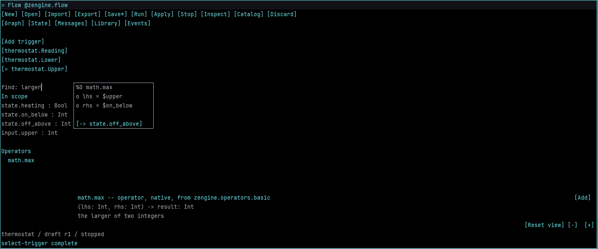
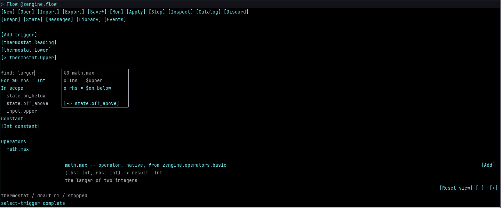
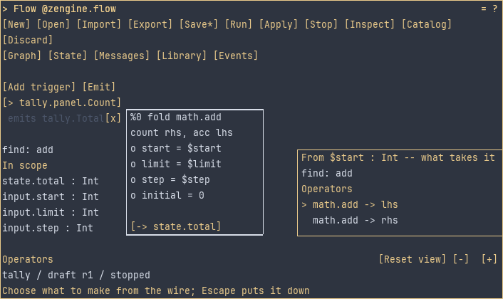
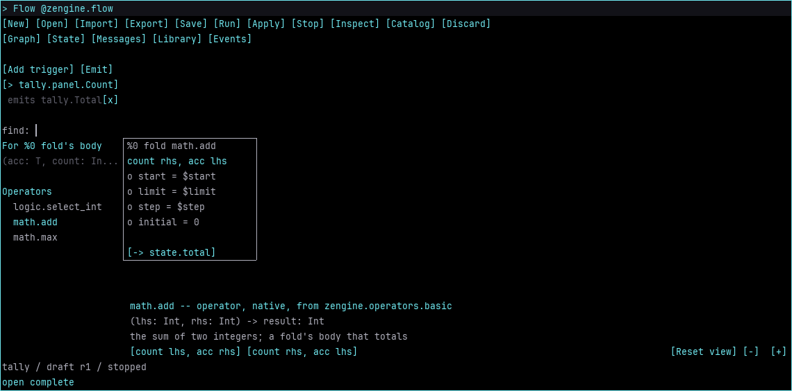
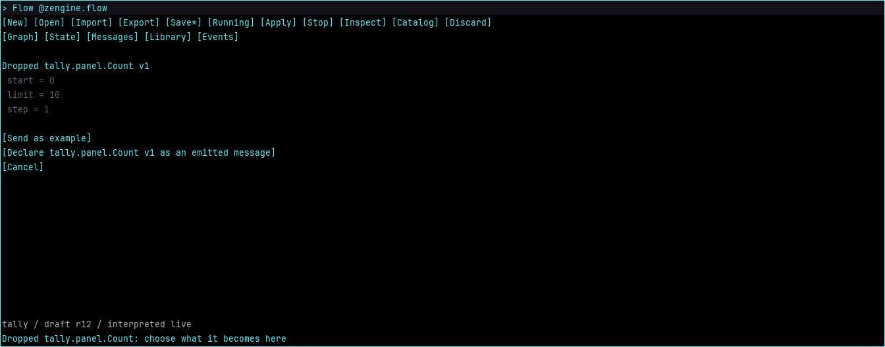
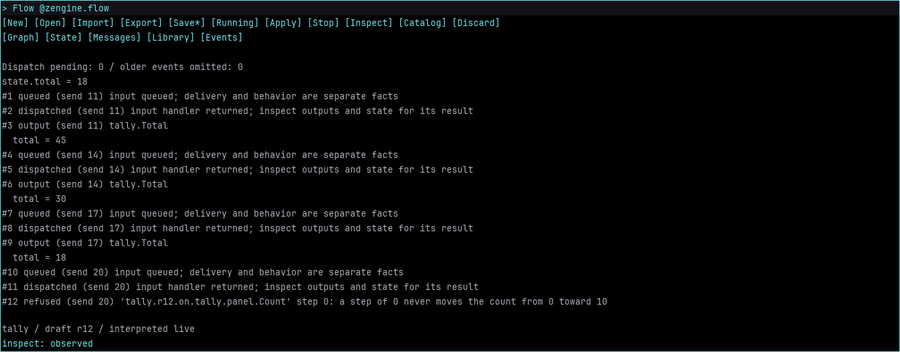
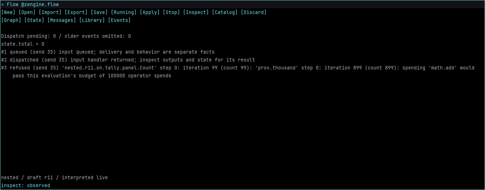
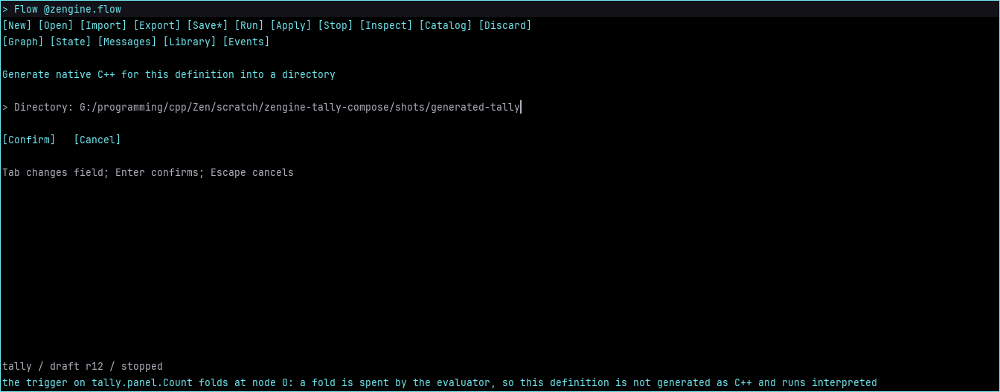

# Author a running graph in Workshop

Flow is a replaceable pane for creating message-driven weaves from the operators available in
the current host. The graph edits a draft. **Run** creates an interpreted participant; **Apply**
changes its behavior while keeping compatible live state; **Restart** runs a draft that hears, keeps
or says something new. A rejected edit leaves it running.

The bar holds **Run**, **Apply** and **Stop** with the rule's state beside them, then **File**,
**View** and a gear for the rest. The Graph page reads the rule as one sentence above the graph,
and the graph has three lanes: **When** a message arrives at the left, **Then** what changes at the
right, and **Do**, the steps between them. The **Next** line under the graph names the one thing
the rule still needs, with a button that does it.

Build and launch [development Workshop](../../workshop/docs/develop-workshop.md), open Pane Manager, and choose
**Flow**. The shipped plans include the optional `zengine-flow-pane` artifact in the `zengine.flow`
office. Enlarge its pane for the graph; room for roughly 100 text columns is comfortable. A host
without the optional canvas protocol receives a textual summary. The independent
[Flow workbench](flow-guide.md) remains available without Workshop. Every command, dialog and
refusal named here is in [the pane's manual](zengine.flow.md).

## Create a high-water tracker

1. Choose **File > New**, name the project `water`, and confirm. The dialog states that it
   replaces the current draft. Save existing work first. Stop an existing run before opening
   another project.
2. Open **State**, choose **Add state field**, and declare `value`, `Int`, `required`. Its initial
   value is zero. Click a value to edit it; **Keep state** installs the completed form as initial
   or saved state. Editing an initial-state form does not change a running participant.
3. Open **Messages**, choose **New message**, and name it `Reading`. Choose **Add field** for
   message index `0`, name `input`, kind `Int`, presence `required`.
4. Open **Graph**. Its Next line asks for the trigger: choose **Use water.Reading**, or the
   gear's **Add a trigger** with message index `0` and state output `value`. Type `larger` (the
   search line in the rail takes what you type) and click `max` under **MATH**. The rail's foot
   previews it: what kind of thing it is, its signature, and what its contributor says it is for.
   Choose **Add to the rule**.
5. Click `input` under **In scope**, then the node's `lhs` port -- or drag from one to the
   other. Click the `rhs` port: the rail lists what could fill it
   ([below](#find-what-to-compose)). Click `value` there. The graph executes in order; forward
   or cyclic connections are refused. Flow names a step by its operator -- `max`, and `max (2)`
   where two share one -- a port by its step, `max's rhs`, and a field by its name.
6. Select the node header and choose **Use as result**. Drag its header to move it; a press on
   blank graph room lets go of it and of a selected port. Drag blank graph room or use the middle
   button to pan; the wheel pans vertically over the graph.
   **View > Zoom out** and **Zoom in** change node positions and widths from 50% to 200%, in 25%
   steps. Text and port-row height stay fixed at the host's measured text size. SDL uses the
   normal Workshop font over Flow's own dark ground; the terminal uses its cell grid. Dragging
   and panning use those same measurements. Saved layouts keep their authored coordinates when
   the font or medium changes. Layout changes do not change executable behavior.
7. Choose **Run**. An unwired port or incompatible type names the place to repair, and the Next
   line leads with **Run needs this first:** and the press that does it. **Run queued** means a
   request was queued; the host's later answer establishes whether the participant exists.

In a dialog, **Tab** selects the next field, **Ctrl+A** selects its text,
<!-- key dialog-confirm -->`return`<!-- /key --> confirms
([`dialog-confirm`](zengine.flow.md#dialog-confirm)), and **Escape** cancels. A refused
confirmation keeps the entered text for correction. A dialog that writes a file -- Save, Export,
Generate native C++, the library's save -- asks Workshop first whether your hand may write one; on
a [weaver's host](../../external-host/docs/external-host.md#whose-host-this-is-and-what-each-power-reaches-there)
a guest's is refused. Confirm or cancel before changing pages, starting another edit, or quitting.

Three open in place instead of over the page: **Keep a field**, **Say a message** and **New
message** open a small box beside what you pressed to open them, with the graph still drawn round
it, and a name they ask for is selected, so what you type replaces it. A kept field's kind is a
row of buttons, **Int**, **Bool**, **Float**, **Text** and **Bytes**, chosen by a press or the
arrow keys rather than typed. A press anywhere outside the box closes it, changing nothing. As you
type a message's name, the names offered beneath it are the ones this rule already says, for a
message it says, and the ones running views name -- a button's message or a label's -- each asked
of its view as the box opens; press one, or move to it with the arrow keys and press **Enter**, to
take it. A name not among them still works. A name the rule hears is never offered: a rule never
hears itself.

## Find what to compose

The rail beside the graph finds operators through the host's
[discovery door](../../introspection/docs/zengine.powers.md), the door the
**Powers** pane and the Terminal ask too, so one question gets the same rows in all three.

- **The search line** takes what you type while no dialog is open. A power matches when each word
  appears in its name or in what its contributor says it is for. The rows come in the catalog's
  order: operators under their namespace's name, such as **MATH**, then **SOURCES**,
  **CONVERSIONS** and **FORMS**, each row its name and what its contributor says it is for,
  broken to two lines rather than cut; a count says how many more matched than one answer
  carries. **FORMS** holds the fold, found by what it is for: type `count` or `total`.
- **A press on a port** opens a small box beside its step: what is in scope of its type, each a
  button by its own name and where it comes from -- a kept field, a field of the message, an
  earlier step's answer -- then one value of the port's own kind: a number for an `Int`, checked
  as you type it, which **Use** or **Enter** binds, or **yes** or **no** for a `Bool`. Its **x**,
  **Escape** or the port pressed again puts it down. The rail meanwhile narrows the search to what
  yields the port's type, and lists before that what is **In scope** of the type, then a typed
  constant, which readies the box's number, then **SOURCES** before the operators.
- **A wire in hand** -- held by a press on a step's answer or on a field -- narrows the rail to
  what takes the wire's type, under **Wire from** what it reads, and the preview offers **Add,
  wired into** each port of that type: the step is placed after what the wire reads and wired
  there. **Escape** puts the wire down, and the rail lists everything again.
- **A row previews; it never runs.** A form and an operator that share a name are two rows, and
  each previews and adds itself. The preview is the door's row, and showing it evaluates
  nothing. **Add to the rule**, or **Enter**, adds the previewed power at the end of the
  trigger's graph, by the reference the row carries; if its ports have changed since it was
  found, Add says so and adds nothing, and so it does when the graph changed while Flow read
  those ports from the host. With a node selected, **Add before** that step places it ahead of the
  node instead, and with a port selected, **Add into** that port places it ahead of the port's node and
  wires it there, so a found operator can feed the port you were filling. The graph executes in
  order, and the nodes that follow are renumbered.
- **A wire let go on empty room asks what it could feed.** Drag from a node's output, or a field
  under **In scope**, and let go on empty graph room: a list opens there of what takes the wire's
  type, a row for each port of that type (`math.add -> lhs`, `math.add -> rhs`), with the search
  line above it. Drag from an input port instead and the list holds what fills it: what is in
  scope of its type, a typed constant, which readies the box at the port, then what yields it.
  Choose a row, by a click or the arrows
  and **Enter**, and the node is made where you let go, wired, and selected, in one edit, after the
  node it reads from or before the port's node. Let go on the other end and the wire binds; let go
  anywhere else and it is put down. **Escape**, or a press outside the list, closes it and makes
  nothing. With a wire held by clicks or a port selected, **View > Find a wire**, or
  <!-- key find-wire -->`ctrl+n`<!-- /key -->, opens the same list at the graph's centre.
- **A fold** runs an operator once for each count from a start toward a limit by a step,
  threading an accumulator. Add it from **FORMS**: it arrives with `step` bound to `1`. Click its
  `body: [choose]` row: the rail then lists only what a fold could spend -- one answer, an `Int`
  port for the count and another port of the answer's type -- and the preview offers each way to
  thread it, such as **count rhs, acc lhs** for `add`. You choose which port takes the count;
  port names only suggest. The node then reads `fold add`, its body row `count rhs, acc lhs`,
  and it is brought into view whole. A reference the slot refuses is put down, so choosing again
  spends the row the door holds now. Wire `start`, `limit`, `step` and `initial`, and any other port of the
  body from scope.
- **What Flow does not offer.** A running definition's trigger body is that participant's own
  reaction, mounted for one revision and gone at the next behaviour edit. Flow asks only for
  powers their contributors offer, so it never lists one; **Powers** lists it and says it is not
  offered.

**Escape** sheds one layer per press: a wire's search, the wire in hand, the selected port, an
open body slot, the preview, the selected node, then the search line, and only then is the pane put
down. **Delete**, or the **x** on its corner, removes the selected node; with none selected, Delete
edits the search line.

## The pointer on the graph

A press on a step's head selects it; drag the head to move the step. A press on empty graph room
lets go of the selected step, its port or a card, and a drag from there pans; the middle button
pans too, and the wheel pans vertically. **Delete**, or the **x** on the selected step's corner,
removes it. A **When** or **Then** card's head selects it, and dragging the head moves the card up
or down its own lane, where it stays.

Two presses on one place within a double click's time are one gesture there:

- **An operator in the rail** is added to **Do**, as **Add to the rule** adds it.
- **Empty Do room** opens a search where it was clicked, `A step here -- what is it for?`: type to
  narrow it, and the row chosen is made there. A click there followed by a drag still pans.
- **Empty When room** asks for a new message.
- **Empty Then room** offers **Keep a field** or **Say a message**.

A wire dragged from a port, a step's answer or a field and let go on empty Do room opens the same
search, listing only what fits; the row chosen is made where the wire was let go, already wired
([Find what to compose](#find-what-to-compose)).

The pointer resting there, with no button held, lights what goes together: a part of the rule's
sentence lights its card, the steps it reads and their wires, and a card or a step lights its parts
of the sentence -- what the rule keeps, every part naming a kept field. Resting on a port tells
its kind and what it reads; on a step's answer or a field, what reads it; on a wire, its two ends,
lit, and the value it last carried. A press ends the rest. A dashed part of the sentence, still to
choose, pressed, does what the Next line's button does.

A wire dragged over a port it does not fit says why under the hand before you let go -- the step
it would read is not before the port's, or it carries another type -- and letting it go there wires
nothing; a press on that port with the wire held by a click says the same and keeps the wire.

## Carry material into Flow

Drag a value from Inventory, Info or Powers onto Flow, or pick it up with the keyboard and click
Flow, and Flow says what it can be here. Carrying copies data; it grants nothing.

- **An operator reference** -- a power dragged out of **Powers**, or one Inventory keeps --
  becomes a node: into the port it lands on, ahead of that port's node; as the body of a fold
  whose `body` row it lands on, the slot opening with it found so you choose the count's port; or
  anywhere else on the graph, at the end of the trigger, where you released it. A reference whose
  operator's ports have changed since it was found is refused with that sentence.
- **A message carried onto the When lane** -- a button's message, from the View Builder's says
  row -- is declared as the message the rule hears, as it came; with a field kept already, it
  wakes the rule at once.
- **Any other value** opens a page of offers: **Send as example** when this definition accepts
  its shape and the participant is running; **Use field = value on %n port** for each field of
  the port's kind when it landed on an `Int` or `Bool` port; **Declare ... as an accepted
  message** when no message of its name is declared, and **as an emitted message** when its name
  is inside the definition's namespace. A dropped shape description -- a carried shape, which
  holds the shapes it nests and is what Flow and the View Builder carry, or a bare
  `zen.SchemaDesc` -- offers the declarations of the shape it describes; a carried shape's page
  names that shape, what it nests and each field's type. A description naming a shape it does
  not carry offers no declaration, and its page says why in Loom's words (`Not declarable: ...`). A declared shape is the one that came -- its name,
  version and fields -- so values of it match it exactly. **Cancel** or **Escape** puts it down,
  and so do **File > New**, **Open** and **Import**, since its offers belong to the graph it
  landed on.

**Carry a shape out of Flow.** In **Messages**, drag a declared message -- an accepted one, or
one under **Emitted** -- and let go over the pane it goes to; or right-press it, choose **Carry**,
then click that pane. What travels is the message's shape, as a description: the
[View Builder](../../view/docs/view-builder.md) takes it onto a label as what that label shows.

## Say what changed: emits

A definition publishes messages of its own after a trigger writes its state field. In
**Messages**, **New emitted** declares one -- a name without a dot is put in the definition's
namespace, and a name outside it is refused, so a definition can only speak for itself -- and
**Add emitted field** gives it fields. The gear's **Add an emit** publishes one after the active
trigger's write: the dialog fills each field from the state field of its name, `total=$total`, and
you may write any field from another state field or a constant instead. The **Then** lane's
**+ say water.Value** does both at once: it declares the message with the kept field it carries
and says it. The **Then** lane lists what the rule says, each with **x** to remove it; drag a say
card by its row of values onto a label to show it there. A **When** or **Then** card's head selects
it, and dragging that head moves the card up or down its own lane, where it stays and is saved with
the workspace; a wire let go on the head of what the rule writes lands there too. An emit is a
publication by this participant, of its own shapes, after every successful write; there is no
conditional emit and no addressed send. A new emitted shape changes what a running participant may
say, so **Restart** it rather than **Apply**; the bar and the Next line offer it, and **Events**
then shows each publication and its fields.

A fold counts at most <!-- value kMaxFoldCount -->10000<!-- /value --> times, and one evaluation
spends at most <!-- value kEvaluationSpends -->100000<!-- /value --> operators and nests at most
<!-- value kEvaluationDepth -->32<!-- /value --> deep, however its folds and calls are arranged;
past any of these the send is refused, the refusal naming each fold's iteration on the way down,
and the state is left as it was.

## Keep examples and exercise the weave

In **Messages**, open `water.Reading`, click `input`, enter `3`, and confirm. **Save example**
stores this as `low`. Change the field to `7` and save `high`. These values are reusable data;
they carry their schemas and no sender identity, destination, grants or reply provenance.

Choose **Send**, then **Events**. Each message the rule took is one line, newest first: what came
in, what changed and what was said, `water.Reading  input 3  ->  value 0 -> 3`; then the host's
other words, such as a refusal in its owner's words, which continue on the rows beneath, and the
current state. The same lines stand under the graph. Dispatch settlement is distinct from an
application result; a quiet weave does not promise a reply. **View > Inspect** refreshes the
owner's bounded record. An omission count says when older observations were dropped. Loom's host
Recorder/Logger remain the broader history tools.

Open `low` in **Library** and send it. The high-water state remains `7`. Return to Graph, click
the `rhs` port, type `10` in the box beside it and press **Enter**. Choose **Apply**, then send `low`
again: the state now becomes `10`. Apply preserves live state and requires the existing
accepted/emitted/state contract.
A schema change needs a restart -- a stop and a fresh run; this pane does not invent a migration
policy.

## Save unfinished work and return to it

**File > Save** writes one workspace containing the definition draft, node positions, view, named
examples, retained forms and saved state. Empty triggers and unwired ports can be saved. Forms
preserve absence, empty text and `false` separately. Missing required fields prevent sending, not
saving. Opening a changed schema retains the previous form under its previous identity.
**Library** also shows retained forms, including those historical shapes.

Click an absent Message or List field to create it. Clicking a present list appends an item;
its nested fields become editable rows. A present Message keeps its existing contents. **unset**
removes a value deliberately. The message-draft C++ API supports structured paths for list
removal; [`FlowEdit`](zengine.flow.md#flowedit) exposes `list-erase(row,index)` for the open form.
Scalar forms use Loom's existing schema-directed composer. Bytes currently require a typed API
value; the text editor does not invent a hexadecimal or base64 spelling.

**Library / Export** and **Import** share named values independently of a Flow project. Reopening
and sending checks schema agreement; an older example is not automatically migrated. The workspace
and library each have a 1 MiB file limit. Saves use the existing atomic file replacement helper.

After execution, newly observed state becomes the saved state unless an explicit initial-state
edit is awaiting a fresh run. The Events page continues to show live state independently. Saving
does not save process identity, pending queues, grants or resumable native continuations.

**File > Export** writes a completed executable Flow project for the standalone workbench and its
C++ generation path. **File > Import** brings such a project into this editor. **File > Generate
C++**, or <!-- key ask-generate -->`ctrl+g`<!-- /key -->, writes the generated project --
`generated.cpp`, its CMake file, `definition.bin` and `graph.svg` -- into a directory, as the
workbench's `generate` does; a definition with a fold is refused in words and nothing is written,
because the fold is the evaluator's and runs interpreted. Workspace files additionally contain
unfinished authoring work and presentation; they are not executable projects.

An orderly Workshop quit is refused while host work or its fresh state inspection is pending.
Try quitting again after the result arrives. Saving an older snapshot while a send is pending
does not bypass that refusal. Save unsaved Flow work, or choose **File > Discard** and type
`discard` to allow closing without saving, or choose `discard unsaved work and quit` in the box
Workshop opens when the quit is refused. Pane reload restores the workspace and reconnects to
the session through its office. The selected page, unconfirmed dialog text and selection, and
the distinction between a deliberate initial-state edit and observed live state also survive
reload. Unconfirmed dialog text is separate from a saved workspace. Drawing grants and hit maps
are reacquired; a held drag ends rather than resuming in the replacement pane.
