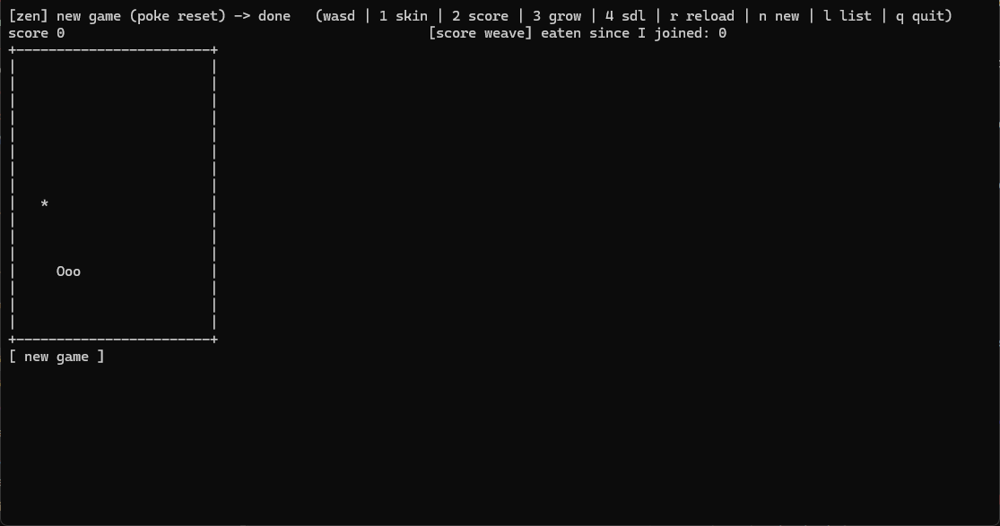
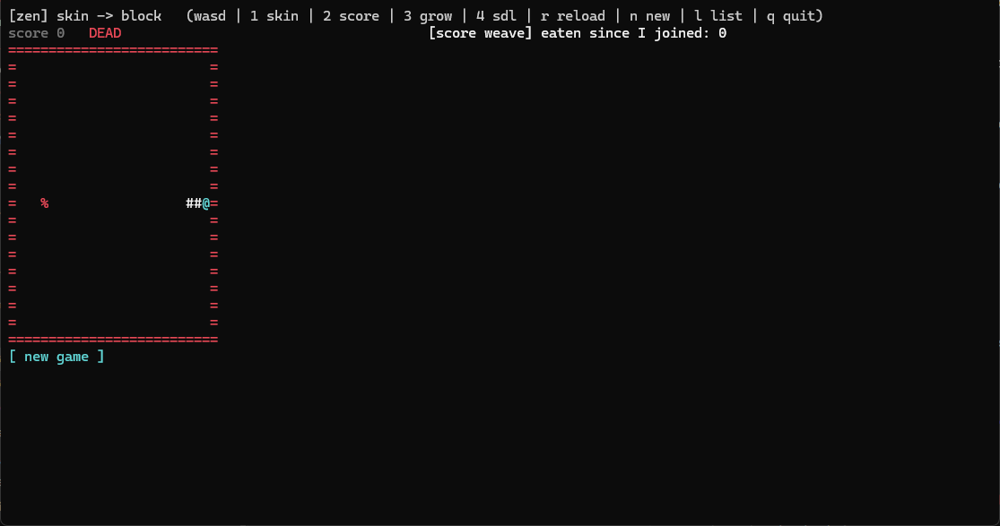

# The Graphics package

A participant that shows something draws it into the window that shows its area. It draws **nodes**
-- the one primitive -- or says an **element** once and then sends only that element's changes.
The window keeps what was drawn, paints it with the skin chosen for the area, and shows only what
changed: the cells that changed on a terminal, the picture once a beat in an OS window. A **directory** introduces each area to its window and tells each owner its
room; nothing a picture is made of passes through it.

A program spells the vocabulary with `#include "graphics/vocabulary.hpp"` and links
`zengine::graphics`. This page is for whoever draws: the vocabulary, the canvas, a drawing weave,
an element of your own, and the two seams a skin or an element's code is written against; and
what a window answers for its platform, on the bus and to C++ in its own process. The
package ships three weaves, each with its manual: the terminal window,
[`zengine.window.terminal`](zengine.window.terminal.md), built as `zengine-window-terminal`; the OS
window, [`zengine.window.sdl`](zengine.window.sdl.md), built as `zengine-window-sdl` where the build
has SDL; and the directory, [`zengine.graphics`](zengine.graphics.md), built as `zengine-graphics`.
Four skins come with them: `zengine-paint-classic` and `zengine-paint-block` paint characters, and
`zengine-paint-day` and `zengine-paint-night` paint light. The snake (`examples/snake/`) is the
worked example: it draws its frame as nodes and its board as an element of its own.





## Who says what

```text
owner -> its window          Drawn (nodes and records), ElementPut once, then ElementChange
window -> the owner          AreaRoom (this window, its incarnation, the room, what it holds,
                             and how it sets text)
window -> the owner          DrawnRefused (why, in words), ActionRequested
window -> pointer's owners   AreaButtonChanged, AreaPointerMoved, AreaWheelTurned
                             (at the area's own point, a press's moments under its number, a
                             button's with what the window drew under the hand)
window -> an area's arranger AreaHandRefused (an injected hand refused in an area the weaver's alone),
                             AreaShown (what the area shows, asked by AreaShowAsked)
window -> its follower       AreaPressed (where a press in an area another office owns landed),
                             AreaSettled (unasked: what the area shows settled, by its version)
input office -> a window     AttributedInput (a participant's moment, landed as that hand's)
window -> owner, follower    AreaHoldEnded, AreaPointerLeft (to the follower when another office)
window -> the keys' owners   AreaKeyPressed, AreaKeyReleased, AreaTextEntered (naming the area
                             and the hand)
arranger -> directory        AreaPlaced, SkinOffered, SkinChosen, ElementCodeOffered
arranger -> its window       WindowShaped (its title and size, from an office arranging there)
window -> everyone           WindowOffered (as its own office: its pixels, incarnation and text)
directory -> window          AreaIntroduced, AreaWithdrawn, ElementCodeOffered
owner -> directory           RoomAsked (an owner that started again)
directory -> everyone        GraphicsReady (a directory that started afresh)
anyone -> a window           ClipboardCopy, PumpSurface, SurfacePlacementRemembered
asker -> a window            ClipboardTextRequested, SurfaceCaptureRequested,
                             SurfaceCaptureChunkRequested
window -> the asker          ClipboardText, SurfaceCaptured, SurfaceCaptureChunk, zen.Refused
OS window -> everyone        SurfacePlacement, SurfaceCloseRequested (as its own office)
```

The **arranger** is whoever a host lets reach the directory: in the snake's host, its operator;
in Workshop, its own weave, which places each pane's area and its own
([`zengine.workshop`](../../workshop/docs/zengine.workshop.md#graphicsready)), and lays its desk
out in the window's room, in its unit and its text, while no skin has said its own
([`WindowOffered`](../../workshop/docs/zengine.workshop.md#windowoffered)).
What each message does is the manual of the office that takes it: the window's for what an owner
sends it, the directory's for what the arranger and a window send it.

An area placed with `keys` hears every key (`AreaKeyPressed`), with `releases` its release
(`AreaKeyReleased`), with `text` the text it types (`AreaTextEntered`): an owner places its areas
for the moments it takes, and is given no other. Each names the area and whose hand made it, as
every pointer moment does: `local`, the weaver's own, or the participant the input office named. One
placed with `pointer`
holds every point inside it, painted or not, and hears, at its own point in pixels, every pointer
moment there as the moment it was: a button pressed or let go, a part's or not
(`AreaButtonChanged`), a move (`AreaPointerMoved`), the wheel (`AreaWheelTurned`). A press holds its
button for the area until its release, so its moves and its release reach the area wherever the
pointer goes, all three under the press's number; the area's arranger, when another office that
follows the area (`AreaPlaced::followed`), hears where each press and release landed
(`AreaPressed`), as a desktop raises what was clicked. A button's moment says what the window drew
under the hand when it landed: the area that showed it, the part named there, and that area's
drawing as its owner numbered it (`Drawn::number`), so the owner acts on the element the press
landed on, and refuses it only where its newest drawing shows another there ([a pane may be
pressed](../../workshop/docs/workshop-panes.md#a-pane-may-be-pressed)). An area placed without the
pointer takes only the points where what it drew names an action or presents an element, and lets
the pointer through to the areas behind it everywhere else. Each time the window shows, it tells the
arranger following an area, unasked, when the area's version moved (`AreaSettled`); of an area its
arranger does not follow, it tells the arranger none of this. Either window, terminal or OS, routes
them alike ([`zengine.window.terminal`](zengine.window.terminal.md#use)).

A window also answers for its platform, in shapes spelled here (`graphics/vocabulary.hpp`): a
copy, a paste's read of the clipboard, its place on the desktop and a place offered back, a close
its desktop asked for, the beat's work on request, and the picture it last presented, retained one
at a time and fetched by chunk. What each window does with them is its manual's; a terminal reads
no clipboard and has no place or close box, so it says none.

## A node, and an element's record beside it

A node is a `path`, an operator `op` and the operator's operands `args`. The path is the owner's
name for the node, unique in its area, and its place: the segments before the last name the node
it lives in, and a node is drawn in its parent's space. A node keeps its place in the paint order
until it is removed; a new node goes after its siblings, and a group is a layer.

An operand's shape is implied by its operator, so `args` is that shape's body alone: Loom's
canonical bytes without the envelope that names the shape (`graphics/implied.hpp`). The window puts
the operator's own envelope back before the one gate reads the operands, so operands of another
shape are refused there.

An `ElementRecord` says what a subtree means: its `type` and `data` (a record shape's value, whole),
and the `action` a press anywhere in it asks of the area's owner.

## The operators

| operator | operands | in a terminal | in light |
|---|---|---|---|
| `group` | an offset, an optional clip | its children's space; paints nothing | the same |
| `rect` | a box, a fill and an outline | the cells it covers; `+ - |` edges | a filled rectangle; edges a pixel wide |
| `ellipse` | a box, a fill and an outline | the cells whose centre falls inside | a span a pixel row; its outline in lines |
| `line` | two points and an ink | a walk of cells in `- | / \` | a line |
| `path` | SVG path data (`M L H V C Q Z`), a fill and an outline | curves flattened; cells by centre | curves flattened; spans a pixel row, even-odd |
| `text` | a point, words and an ink | one cell a character; outside ASCII, `?` | a run of text, a character every advance of the window's face (`PaintTask::text_advance`); outside ASCII, `?`; a line a clip crosses cut by its pixels |
| `image` | a box and pixels, four bytes each | a luminance ramp, one glyph a cell | its pixels, scaled into its box |

Coordinates are the area's pixels; a terminal floors each edge to its cell of
<!-- value kCellPx -->12<!-- /value --> pixels. `graphics/pixels.hpp` is the arithmetic on both:
sums and floors that cannot overflow, a pixel in a medium's device unit, and the grain a hit test
floors by. A colour is a `Paint`: a theme role (`graphics/role.hpp`), or an exact `0xRRGGBB` beside
the role a medium without colour shows it as. An operator a skin does not know is painted as its
name, muted, never silently dropped.

## Drawing: a canvas, and one showing a beat

`graphics/canvas.hpp` is what an owner draws with. A `Sketch` collects one picture; a `Canvas`,
kept for the owner's life, remembers what it last sent its window, so a whole picture drawn again
sends only the nodes that changed. A beat queues its picture (`draw`), an element it presents
(`present`) and its elements' changes (`change`), and `show` sends them, its nodes before its
elements: every message but the last says `more` follows, and the window shows once, after the
last. A tick that changes the snake's board and its score is one showing.

A canvas draws whole when its window is new, started again, resized or sets text another way, or
the window says the area is empty. The window tells the room (`AreaRoom`): its name, its
incarnation, its width and height (`width()`, `height()`), the references of the owner's elements
it still presents there, whether it holds none of the owner's drawing there (`empty`): an area
shown afresh, or given to this owner; and how it sets text (`text()`, a `TextMeasure`: a
character's advance and a line's height in pixels, the OS window's face or a terminal's cell, and
`cell_px()`, its device pixels in a cell). An owner places its text by that measure, a row a line
and a character an advance, and paints its area's ground: what it leaves unpainted shows what
stands behind it. `room` answers whether the window, its incarnation, its size or its measure
changed or the area is empty, and `holds` whether the window presents an element, so an owner says
again only what the window does not hold.

## Drawing the text pieces

`graphics/elements/text_face.hpp` holds the text pieces' looks, a face each medium's, drawn from the
values `component/` keeps measured in characters, and keeps nothing itself. A text box keeps a
column on each side of its text (`kTextBoxInset`): in a row of cells `[text___]`
(`text_box_spelling`), where the window sets type its outline in `role::kEdge` round its text,
selection and caret (`text_box_face`). A text area in a row of cells shows its lines between
`N more above...` and `... N more below` (`text_area_cells`, read back by
`text_area_cells_place`). `text_area_face` draws a text area scrolled freely: its lines from the
scroll's place, the first and last cut by their pixels where the scroll stands between two lines,
the selection on a muted ground behind its text, and the bar's thumb in a room kept on the right
whether or not the text overflows (`kTextAreaBarRoom`, drawn `kTextAreaBarDrawn` wide), pressed
across all of that room. The owner reads a press with the geometry the face was drawn with
(`text_area_geometry`, `text_area_place_at`, `text_area_on_bar`, `text_area_bar_scroll`), so a
press lands where the face showed.

## A drawing weave

`graphics/drawing.hpp` owns what every drawer would otherwise repeat, so a drawer writes its
picture and what it reacts to. A weave attaches `graphics::DrawingFacet` through `With` (or uses
the single-facet shorthand `DrawingWeave`):

```cpp
class ScoreWeave
    : public graphics::With<graphics::DrawingFacet>::Weave<ScoreWeave, ScoreState,
                                                           loom::Accept<FoodEaten>> {
public:
    using Weave::on;
    ScoreWeave() : Weave("snake.score") {} // the office it draws as; its area by default
    void on(const FoodEaten&, loom::Mail&) { ++state_.eaten; }
    void picture(graphics::Sketch& f) const {
        f.text("eaten", 0, 0, std::to_string(state_.eaten),
               graphics::by_role(graphics::role::kFill));
    }
};
```

The drawing facet takes the room from the window it names, asks its room after the first message
each life delivers it while no room has come (a loaded weave's activation, where it hears one),
and takes a refusal and does nothing with it. At the end of every delivery, and of every poke that
wrote the state, `With` runs the weave's own `after_delivery` (when present) and then each facet's
`after_delivery` in declaration order, where `DrawingFacet` draws the drawer's `picture` and shows
the beat: a drawer never calls `show`. An optional `on_room` runs when the window, its incarnation,
or its size changed, where an element the window does not hold is said again (`canvas().holds`).
A drawer that presents elements emits `ElementPut` and `ElementChange` itself and accepts the
presses it wants. A drawer whose parts name actions composes `graphics::ActionFacet` in place of
`DrawingFacet`: the same facet, also taking `ActionRequested`, which is the drawer's
`on_action(action, mail)` only when the window that shows the drawer's area asks it, as that
window's office, about that area; a drawer without actions keeps `DrawingFacet` and accepts no
`ActionRequested`:

```cpp
class NewGame
    : public graphics::With<graphics::ActionFacet>::Weave<NewGame, NewGameState,
                                                          loom::Accept<>> {
public:
    using Weave::on;
    NewGame() : Weave("demo.new-game") {}
    void on_action(const std::string& action, loom::Mail&) {
        if (action == "new-game") ++state_.games;
    }
    void picture(graphics::Sketch& f) const {
        graphics::Button button("new-game", " new game ");
        button.set_bounds(0, 0, 12 * graphics::kCellPx, graphics::kCellPx);
        button.sketch(f, "new-game"); // the action a press on it asks
    }
};
```

A pane Workshop seats draws the same way. `workshop::PaneDrawingFacet`
([`workshop/pane_facets.hpp`](../../workshop/pane_facets.hpp)) holds the pane's room in Workshop
and in a window alike: the weave writes one `picture(graphics::Sketch&)` and one
`on_action(action, mail)`, and calls the facet's `show` where its state changed. The window that
shows the area named by the pane's office is sent what changed; Workshop is sent the same picture
as the pane's rows, each record a part named by its path. A press on a part, in the window or on
Workshop's canvas, reaches `on_action` as the action its record names, so the owner never reads a
place ([The pane facets](../../workshop/docs/workshop-panes.md#the-pane-facets)).

Over the Timer, a drawer passes `zengine::timer::TimedWeave` as the `Base`
parameter to `Weave`; the single-facet `DrawingWeave` shorthand keeps the compile-time wall on a
derived `after_delivery`. A weave that claims names its `loom::Claims<...>` after `loom::WeaveBase`
(`Weave<Self, State, Accept, Emit, loom::WeaveBase, loom::Claims<...>>`); a facet may declare
`Claims` of its own, and the weave declares the union, each shape once. Over the Timer a weave
claims nothing.

## An element of your own

An element is presented by code the window opens, as it opens a skin. Its owner says it once
(`ElementPut`: the area, the path, the type, the owner's reference for it, and its data, whole)
and then sends each change by that reference and the change's index among the changes the code
takes (`ElementChange`); the type implies each change's shape, so a change is its body alone. The
code draws what it is told -- the rules stay the owner's. A press it does not take reaches the
owner as the press itself (`AreaButtonChanged`) where the area was placed with `pointer` true, or
else as the action its record names (`ActionRequested`); otherwise it sends nothing.

`graphics/element_export.hpp` exports one with a struct and a macro:

```cpp
struct BoardCode {
    using Data = SnakeBoardData;                       // said once, whole
    using State = SnakeBoardState;                     // kept by the window between events
    using Changes = std::tuple<SnakeStep, SnakeNewGame>; // the wire's order: grows at its end
    static State start(const Data& d);
    static void change(State& s, const SnakeStep& step);  // one overload a change
    static void change(State& s, const SnakeNewGame& game);
    static bool press(State& s, const std::string& node, const std::string& path);
    static void draw(const State& s, graphics::Sketch& f, const std::string& path);
};
ZENGINE_EXPORT_ELEMENT(BoardCode)
```

The code draws its whole element from its state each time; the window is handed the difference
from the drawing before, so only what changed is painted. The window keeps each element's state
and hands it in with every event, naming the element by a handle of its own.

A change travels as its index in `Changes`, so the list's order is a wire contract: it only grows
at its end. A change of a type outside the list, or listed twice, does not compile where its owner
sends it (`Canvas::change`).

## The two seams

A skin and an element's code are libraries a window opens by path, as operator providers are
opened (`operator/image.hpp`), and calls in its own handler: no message, no participant. Each
library exports one C symbol answering a table whose version the window reads first and refuses
when it is another; bytes cross as Loom canonical values through sinks the window owns, and every
answer is read through the one gate. Ours and a stranger's are opened and judged alike.

| seam | symbol | in | out |
|---|---|---|---|
| a skin (`painter_abi.h`) | `zengine_painter` | `PaintTask` | `PaintResult` |
| element code (`element_abi.h`) | `zengine_element` | `ElementEvent` | `ElementOutcome` |

A skin for a terminal is the shared painter (`graphics/term_paint.hpp`) and a look -- a glyph for
each role, the glyphs an outline wears -- exported by `ZENGINE_EXPORT_PAINTER`. A skin for light is
the painter for light (`graphics/light_paint.hpp`) and a look -- a colour for each role and a
ground -- exported by `ZENGINE_EXPORT_LIGHT_PAINTER`; each node's pixel primitives cross the seam
packed in its `NodePaint`'s cells behind a tag, so a window tells a skin for light from one for
characters by what it answers. Which library holds
a skin or an element's code is the load plan's word, through the arranger and the directory, never
a pane's. What a window says of a library it cannot open or read is
[the window's manual](zengine.window.terminal.md#files).

## A window in its own process

C++ in a window's own process -- a host's, beside the window it loaded -- may ask the window
(`Window<Medium>`, `graphics/window/window.hpp`) directly for what its messages carry, and each
medium answers for its platform:

| ask | the terminal window | the OS window |
|---|---|---|
| `clipboard_copy(text)` | the text written to the terminal as OSC 52 (`window::terminal_clipboard_sequence`), which no terminal confirms | the text put on the platform's clipboard |
| `clipboard_text()` | none: no terminal route reads a clipboard | the clipboard's text, read only when asked and never on the window's beat; empty when it holds no text, none with no window |
| `placement()` | none: the terminal's window is its emulator's | its normal top-left on the desktop and whether it is maximized; none with no window, or one never seen unmaximized |
| `place(want)` | nothing | moved to `want`, whole on a display; a maximize waits for the window's next picture and lands on the beat after it |
| `capture()` | the cells it last showed, `text/cells`: a row of `width` glyphs a line, each ending in a newline, `cell_px` 0 | the picture it last presented, drawn again and read back: `image/bmp`, 24-bit and bottom-up (`window::bmp_of_bgr24`), in pixels, `cell_px` `kCellPx` |

`capture()` answers none before the window has shown anything, and never shows what a drawing
saying `more` still holds back. A close its desktop asked for is published, not kept: the beat that
reads it publishes `SurfaceCloseRequested` as the window's office, once. The OS window opens
centred on its display's usable area, and an area placed past its edge grows it, as far as that
display holds it, once for each new reach: a window a weaver made smaller is not grown back while
its areas stay where they are. An office that arranges an area in a window names it and sizes it
(`WindowShaped`): the OS window keeps the size within its display and, as after a weaver's
resize, is not grown back while its areas reach no further; the terminal keeps its own.
