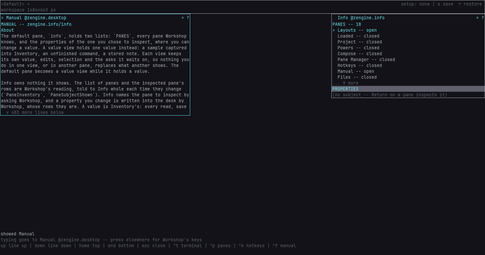

# Info

**A Workshop pane for looking closely at things: the panes on your desk and their properties, and
typed values kept in Inventory. Several Info views can stay open at once, and nothing you do
elsewhere replaces what one shows.**

The default view lists your panes and shows the properties of the one you pick, where you can
change them. More views each hold one value, such as a captured sample, an unfinished
command or a stored note: edit it, save it or a copy, watch it for changes, ask a sample's
source for a fresh one, or fill one of its fields by dragging a field from another view.

## Pages

- [`zengine.info` -- Info](docs/zengine.info.md): the manual -- every command of the lists, a
  property draft and a value view, what each says, and what the pane shows
- [Independent Info views and the inspection workbench](docs/info-views.md): one story through
  several views at once, on a ready-made set of values to try it with

## What is in this folder

| | |
|---|---|
| `pane.cpp` | the pane itself, built as a weave Workshop loads (`zengine-info-pane`) |
| `value_view.hpp` | one value view: the value it holds, your unsaved edits, and what it is waiting for |
| `vocabulary.hpp` | the names it is known by (`zengine.info`), the actions your keymap file can move, and what it keeps when reloaded |
| `CMakeLists.txt` | how the pane is built |
| `docs/` | these pages |

Working on it: [AGENTS.md](AGENTS.md).
