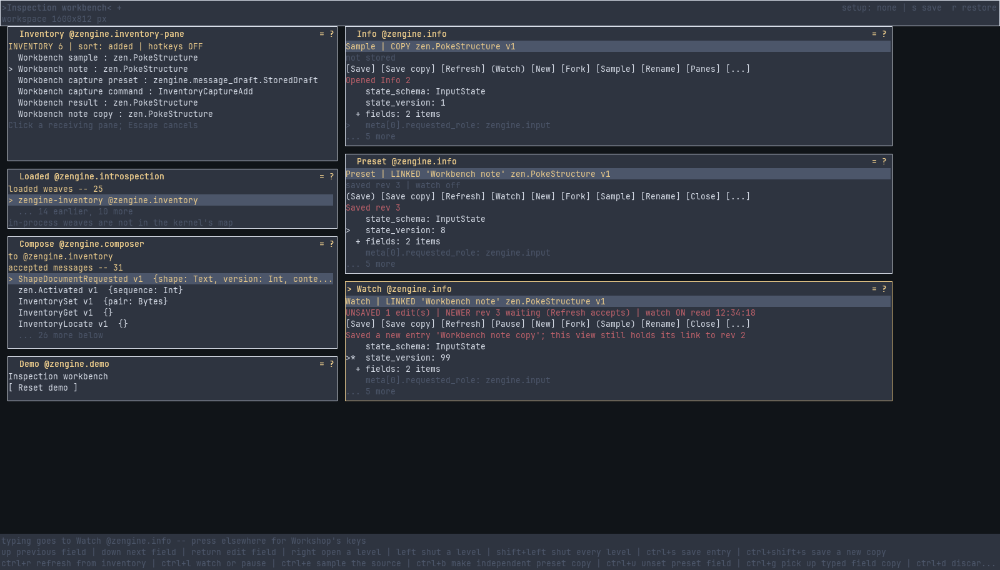
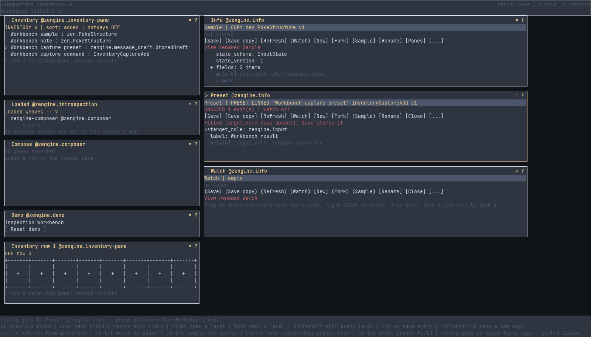
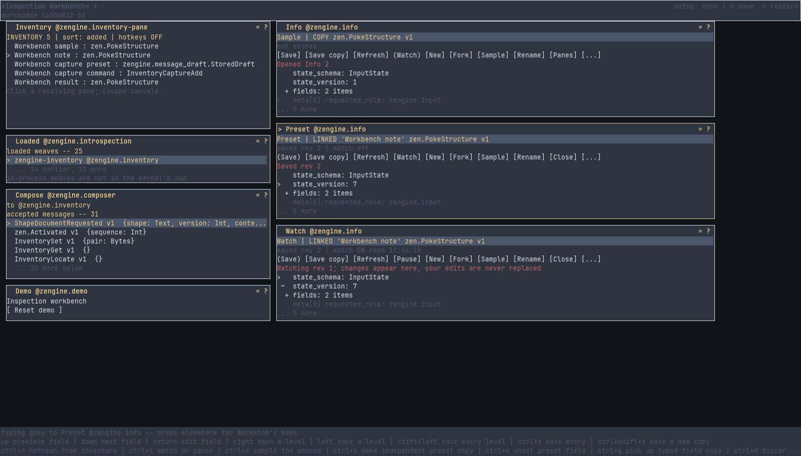
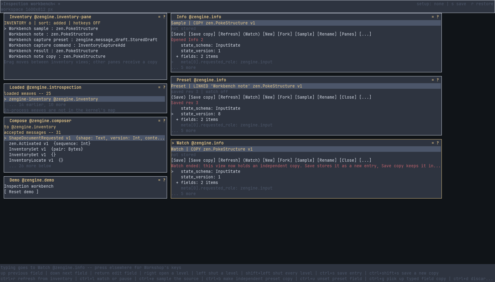
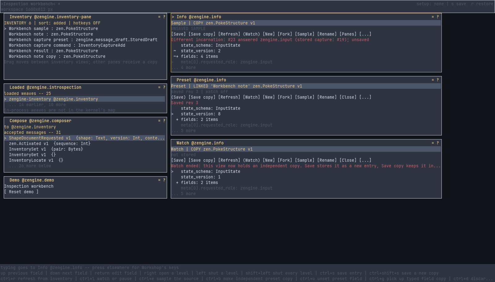

# Independent Info views and the inspection workbench

Keep several typed values open at once: a captured sample in one Info view, an incomplete command
preset in a second, a watched note in a third. Each view holds its own subject, draft, selection
and pending work, so changing focus or using another pane never replaces what a view shows.



This page walks one story through them, on a desk and a toolbox made for it. What each control
does, and every sentence a view says, is in [Info's manual](zengine.info.md#commands-in-a-value-view).

## The inspection workbench

The repository keeps a small filled toolbox for trying and testing this story:
`external-host/tools/workshop/toolboxes/inspection-workbench.toolbox`. It holds a nested typed
sample of `zengine.input`'s structure, a mutable note of the same shape, an incomplete
`InventoryCaptureAdd` preset missing its `target_role`, and the complete command. The
[`workbench` setup](../../workshop/docs/demo-setups.md) prepares a matching desk with that toolbox already restored,
its command in a row bound to **Alt+1** and turned ON:

```sh
python external-host/demo.py start --setup workbench --root demo-runs/workbench --build build --loom-prefix ../Loom/build/_install
loom-session run demo-runs/workbench/session workshop/workbench --name story --input phase=story --wait 300
python external-host/demo.py stop --root demo-runs/workbench
```

`loom-session run` returns as soon as a run starts unless `--wait` is given, so each step above
waits for its run to end before the next begins. `story` finds every entry again by name
(references from an earlier run are never reused), names the three views, finishes the preset
from the sample field to field, saves, closes and reopens it, submits it through Compose (one new
`Workbench result` entry), watches the note while another view changes it, keeps a dirty draft
through a stale save, ends a watch by opening a whole value in its view, and samples the source
again. Its `workbench.json` counts weaver gestures, remote asks and picture transfer separately.
**Reset demo** returns the desk, empties the views and restores the four entries' values and
labels; entries you made, such as `Workbench result` captures, stay. `phase=restore` still
replaces a Workshop's collection with the packaged toolbox in one request -- into your own
Workshop too, so save yours first.

An organized copy, with the same entries filed in `Workbench/Samples` and
`Workbench/Commands/Drafts` and its command in a row, has its own
[folder story](../../inventory/docs/inventory-folders.md#the-organized-workbench).

To extend the workbench, add material through its owners in `prepare` of
`external-host/tools/workshop/workbench.py`, then regenerate the file in a demo without workbench entries (the `commands` setup has Loaded and Compose):
`--input phase=prepare --input path=<absolute path of the packaged file>`. Never edit its bytes or
identities by hand. Fork it (a new file name and label prefix) for an experiment that should not
change the shared baseline. After a schema change, run `restore` and `story` in a fresh demo: a
preset whose command changed shape is refused by Compose, which tells you to regenerate.

## What the story shows

**A preset finished from a sample, field by field.** The Preset view's `target_role` is filled by
dragging the Sample view's recorded source role onto it ([`inventory.grab`](zengine.info.md#inventorygrab)
picks a field up from the keys). Only that field changes; every other field, present or absent,
stays as it was.



**A watched note.** The Watch view follows the note ([`inventory.watch`](zengine.info.md#inventorywatch))
and takes the save the Preset view made, marking the changed field `~`. A view holding unsaved
edits would keep them, and say newer data is waiting.



**A watch that ends.** Dropping the sample on the watching view opens it there as an independent
copy, and the watch on the note ends, at Workshop too.



**A fresh sample.** The Sample view asks `zengine.input` to describe itself again
([`inventory.sample`](zengine.info.md#inventorysample)): the answer stands beside the stored original,
unsaved, saying who answered and when, until it is saved. Inventory's entries outlive the run in
[toolboxes](../../inventory/docs/toolboxes.md); the views do not.


