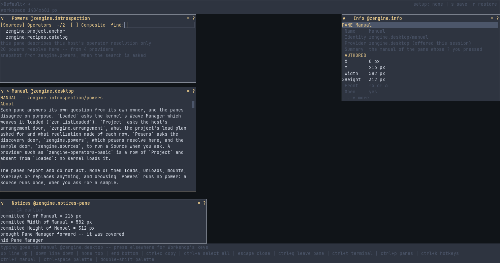

# Introspection

**Three Workshop panes that show what the running program is made of. A weaver opens `Loaded`,
`Project` and `Powers` from the Pane Manager to see which weaves are loaded, what the project
asked for and what came of it, and which powers the program can use and who supplies each.**

`Powers` is a browser: search powers by name or by what they are for, and sample a Source on
request. The panes report and do not act: none of them loads, unloads or mounts anything, and a
Source runs only when you ask for a sample. Each pane asks for its facts when it is given an area
to draw in, and again when it scrolls: Loaded asks Loom's Manager, Project asks Workshop's
arrangement door, and Powers asks its discovery door and, for a sample, its sample door. Workshop
loads them at start; they are not part of the installed package.

## Pages

- [`zengine.introspection` -- Loaded, Project and Powers](docs/zengine.introspection.md): the
  panes' manual -- what each pane shows, where each fact comes from, and how to find and sample a
  power
- the doors these panes ask are Workshop's, and their manuals stand with it: the
  [arrangement door](../workshop/docs/zengine.arrangement.md), the
  [discovery door](../workshop/docs/zengine.powers.md) and the
  [sample door](../workshop/docs/zengine.sources.md)

## Parts

| file | what it holds |
|---|---|
| `introspection.cpp` | the loadable weave `zengine-introspection`, role `zengine.introspection`, which routes each delivery to its pane's seat |
| `seats.hpp` | the weave's three panes, each in a seat: `PaneSeat` (an area, its question, its pictures), `LoadedSeat`, `ArrangementSeat` and `PowersSeat` |
| `vocabulary.hpp` | the lasting names: the role, the pane keys, Powers' action ids, the library stem and `LoadedSelected` |
| `loaded.hpp` | the Loaded pane's view, as pure code: `parse_loaded`, `project_loaded`, `mark_selected` |
| `resolved.hpp` | the Project pane's view, `project_arrangement`, and the budget Powers shares |
| `powers.hpp` | the Powers pane's pure half: `PowersUi`, `powers_question`, `project_powers_ui` |
| `powers_detail.hpp` | the Powers pane's words and row geometry: the chrome's fit, the list's window, a power's line, the detail and sample rows |
| `docs/zengine.introspection.md` | the weave's manual, answered for each of its panes; `docs/images/` holds its pictures |
| `CMakeLists.txt` | `zengine-introspection-view` (header-only, the pure headers) and the weave, which carries the manual |

## Working on it

The repository's guide is [CONTRIBUTING.md](../CONTRIBUTING.md); this section is what a change in
`introspection/` adds to it.

**Law.** The panes keep the pane seam's law ([the pane seam](../agents/panes.md): the Loaded pane,
"The system can show what it is", and the Powers pane), which the guide routes. What each pane
shows is [its manual](docs/zengine.introspection.md). A rule about one declaration is in that
declaration's comment.

**The manual is compiled in.** `zengine-introspection` carries `docs/zengine.introspection.md` and
answers it for each pane when asked, so an edit to the manual is a build: the panes' manual
witness, in `workshop_panes_inspect`, holds it to the actions each pane declares, and the `manual`
check holds its form.

**Suites.** The folder has no CTest entry of its own; its cases stand in shared suites, each run
through the official lane, `tests/verify.cmake`. In `workshop_panes_inspect`,
`tests/test_workshop_panes_introspection.cpp` and `tests/test_workshop_panes_sampling.cpp` drive the
panes and also read this folder's sources as text; the first file holds the panes' manual witness
and their census driver, whose rows are `tests/actions/zengine.introspection.txt`. The Powers pane
is driven in `workshop_panes_terminal` (`tests/test_workshop_panes_powers.cpp`) and its presses in
`workshop_panes_hand` (`tests/test_workshop_panes_input.cpp`), each door's manual witness beside its
cases; `workshop_screen` (`tests/test_workshop_screen.cpp`), `workshop_load`
(`tests/test_workshop_load.cpp`) and `workshop_document` (`tests/test_workshop_document.cpp`, a
Compose target picked on the Loaded pane) hold cases of it too.

**The host's side.**

- Loading: an optional row of `workshop/default-load-plan.json`, role `zengine.introspection`;
  `workshop/CMakeLists.txt` stages the weave and lists it as a pane weave.
- The seam: its panes speak the pane protocol, `pane/vocabulary.hpp`, and the `workshop/pane_*.hpp`
  parts `introspection.cpp` includes.
- The doors it asks, mounted in `workshop/workshop.cpp`: `zengine.arrangement`
  (`workshop/arrangement.hpp`, `workshop/arrangement_vocabulary.hpp`), `zengine.powers`
  (`workshop/powers_door.hpp`, `workshop/powers_vocabulary.hpp`) and `zengine.sources`
  (`workshop/sample_door.hpp`, `workshop/sample_vocabulary.hpp`); Loom's Manager answers
  `zen.ListLoaded`. Each door carries its manual from Workshop's `docs/` (`zengine_manual` on
  `zengine-workshop-load` and `zengine-workshop-vocabulary`) and answers `ShapeDocumentRequested`
  from it.
- `composer/composer.cpp` hears its `LoadedSelected`.

**Practice.** [Loaded, Project and
Powers](../docs/contributing/best-practices.md#loaded-project-and-powers-introspection).
