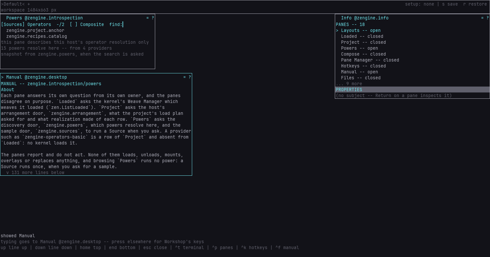

# Introspection

**Three Workshop panes that show what the running program is made of. A weaver opens `Loaded`,
`Project` and `Powers` from the Pane Manager to see which weaves are loaded, what the project
asked for and what came of it, and which powers the program can use and who supplies each.**

`Powers` is a browser: search powers by name or by what they are for, and sample a Source on
request. The panes report and do not act: none of them loads, unloads or mounts anything, and a
Source runs only when you ask for a sample. Workshop loads them at start; they are not part of
the installed package.

## Pages

- [`zengine.introspection` -- Loaded, Project and Powers](docs/zengine.introspection.md): the
  panes' manual -- what each pane shows, where each fact comes from, and how to find and sample a
  power
- [`zengine.arrangement` -- the arrangement door](docs/zengine.arrangement.md): the office the
  `Project` pane asks what the project asked for and what came of it
- [`zengine.powers` -- the discovery door](docs/zengine.powers.md): the office `Powers`, Flow and
  the Terminal ask to find a power
- [`zengine.sources` -- the sample door](docs/zengine.sources.md): the one office that may run a
  Source

## What is in this folder

| | |
|---|---|
| `introspection.cpp` | the weave Workshop loads, offering the three panes |
| `vocabulary.hpp` | the names the panes and their actions are known by |
| `loaded.hpp`, `resolved.hpp`, `powers.hpp` | how each of the three panes turns facts into rows |
| `CMakeLists.txt` | how it is built |
| `docs/` | these pages |

Working on it: [AGENTS.md](AGENTS.md).
