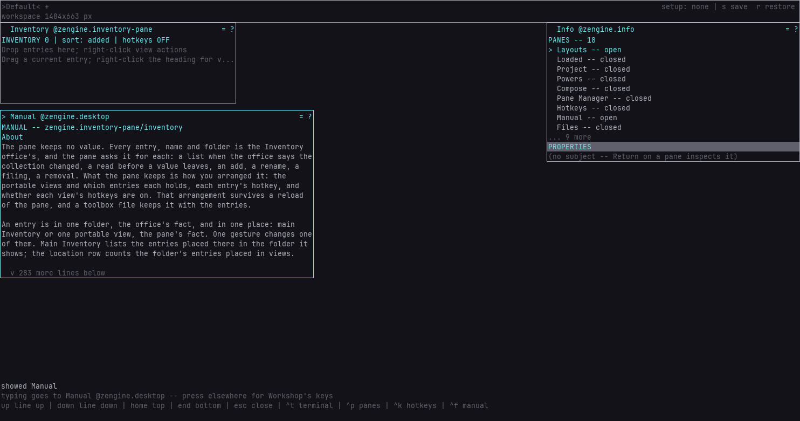

# Inventory

**Inventory keeps the values you want to use again (a sample you picked up, a filled-in message,
a command) as named entries, each with a separate record of how it was captured. In Workshop you
browse them in folders, drop them into other panes, put commands on hotkeys and save the whole
collection as a toolbox file for another session.**

A program gets the same collection as a library and a loadable weave that keeps it. It links
`zengine::inventory` and spells the format of one entry `#include "inventory/codec.hpp"`, the
messages that add, list, read and capture entries `#include "inventory/vocabulary.hpp"`, the
permissions a host may give the Inventory office `#include "inventory/grant.hpp"`, and the pane's
own messages `#include "inventory/inventory-pane/vocabulary.hpp"`.

## Manuals

- [The Inventory pane](docs/zengine.inventory-pane.md), `zengine.inventory-pane`: every command,
  by its key: browsing folders, picking up and filing entries, portable views and hotkeys, toolbox
  files
- [Inventory](docs/zengine.inventory.md), `zengine.inventory`: the office that keeps the entries,
  and the messages another weave sends it

## Pages

- [The Inventory pair](docs/inventory.md): the format of one entry, its metadata, and the reader
- [Organize Inventory in named folders](docs/inventory-folders.md): make, nest and fill folders
- [Portable inventory toolboxes](docs/inventory-slots.md): boxes, rows, columns and hotkeys
- [Reuse a stored command through Compose](docs/inventory-compose.md): fill a command from entries
- [Save a toolbox for another session](docs/toolboxes.md): save to a file, restore later

## What is in this folder

| | |
|---|---|
| `weave.hpp`, `inventory.cpp` | the weave that keeps the collection (`zengine-inventory`) |
| `codec.hpp` | the byte format of one entry: an item and its metadata |
| `vocabulary.hpp` | the messages, and the office name `zengine.inventory` |
| `grant.hpp` | the bounded permissions a host may give the Inventory office |
| `folders.hpp`, `archive.hpp` | the rules for folders and for a saved collection |
| `observation.hpp`, `pane_client.hpp` | helpers other panes share with Inventory |
| `read.cpp` | `zengine-inventory-read`, a program that prints an entry saved to a file as JSON |
| `inventory-pane/` | the Inventory pane, a weave Workshop loads (`zengine-inventory-pane`) |
| `CMakeLists.txt` | the build |
| `docs/` | these pages |

Working on it: [AGENTS.md](AGENTS.md).
