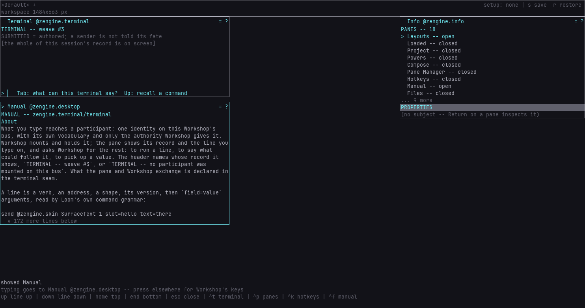

# Terminal

**The Terminal is the Workshop pane where a weaver types a line and it becomes a message to the
weaves running in that Workshop. It recalls the commands you have run, scrolls back through
everything the session has said, and offers, as you type, the destinations that are there now.**

It speaks as a participant of its own, with only the authority Workshop gives it; it is not a
shell and starts no programs. Press `Ctrl`+`t` in Workshop to open it.

## Pages

- [`zengine.terminal`](docs/zengine.terminal.md), the Terminal's manual: open the pane, send and
  ask, recall a command, read back through the record, choose where a message goes, and leave it
- [Terminal](docs/terminal.md): hide the legend in one layout, keep a command or a reply in
  Inventory, and find a power from the line

## What is in this folder

| | |
|---|---|
| `pane.cpp` | the Terminal pane, built as a weave that Workshop loads |
| `vocabulary.hpp` | its names: the office it holds (`zengine.terminal`), its pane, its key actions and its settings |
| `CMakeLists.txt` | how it is built |
| `docs/` | these pages and their screenshots |

Working on it: [AGENTS.md](AGENTS.md).
