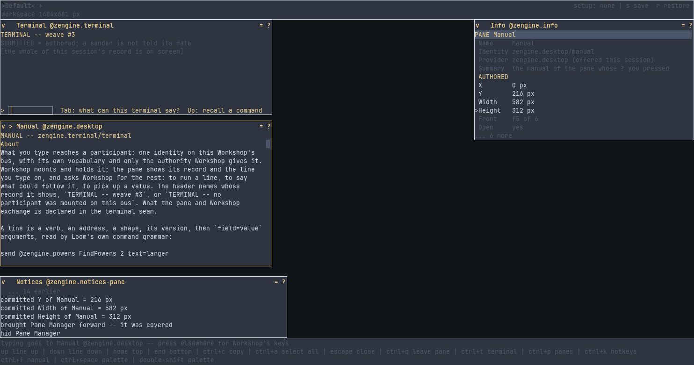

# Terminal

**The Terminal is the Workshop pane where a weaver types a line and it becomes a message to the
weaves running in that Workshop. It recalls the commands you have run, scrolls back through
everything the session has said, and offers, as you type, the destinations that are there now.**

It speaks as a participant of its own, with only the authority Workshop gives it; it is not a
shell and starts no programs. Press `Ctrl`+`t` in Workshop to open it.

## Pages

- [`zengine.terminal`](docs/zengine.terminal.md), the Terminal's manual: open the pane, send and
  ask, recall a command, read back through the record, choose where a message goes, and leave it
- [Terminal](docs/terminal.md): hide the legend in one layout, keep a command or a reply in
  Inventory, and find a power from the line
- [The Terminal's laws](docs/terminal-laws.md): a pane nothing global reaches, an image that cannot
  reach the participant, and a completion answer that applies only to the line it was asked about

## Parts

| file | what it holds |
|---|---|
| `pane.cpp` | `zengine-terminal-pane`, a loadable weave: its offer, its settings, its keys and presses, the value pickup and the act |
| `view.hpp` | the record wrapped into rows, the view onto them, and the pane's rows and caret composed |
| `history_and_completion.hpp` | the commands recalled from the record, and the completion ask and its list's cursor |
| `vocabulary.hpp` | its durable names: the role `zengine.terminal`, its pane, its stem, its actions and settings, and what a reload keeps |
| `CMakeLists.txt` | builds the weave; skipped where Loom cannot host loadable weaves |
| `docs/` | these pages and their screenshots; the manual is compiled into the weave and answered when asked |

`view.hpp` and `history_and_completion.hpp` define members of the class `pane.cpp` declares, and
only `pane.cpp` includes them, after the class. The door onto the participant, its completer and
the picture of its record are Workshop's, in `workshop/terminal/`: Workshop's weave composes the
door and compiles all three, and the pane includes none of them (WL-TERM-08).

## Working on it

The repository's guide is [CONTRIBUTING.md](../CONTRIBUTING.md); this section is what a change in
`terminal/` adds to it.

**Law.** Three numbered laws, on [the Terminal's laws](docs/terminal-laws.md): the Terminal is a
pane and nothing global reaches it (WL-TERM-01), its image cannot reach the participant it presents
(WL-TERM-08), and a completion answer applies only to the line and caret it was asked about
(WL-TERM-11). Their proofs are listed in `tests/laws/terminal.txt`. The participant, the door onto
it and the completer are Workshop's, and so are their laws.

**Suites.** The folder has no suite of its own; its cases stand in suites Workshop's router claims,
each run through the official lane, `tests/verify.cmake`. `workshop_panes_terminal`
(`tests/test_workshop_panes_terminal.cpp`, which also reads `pane.cpp` and `CMakeLists.txt` as text,
and the Terminal's cases in `tests/test_workshop_panes_powers.cpp`) holds most of them;
`workshop_panes_settings` (`tests/test_workshop_panes_legend.cpp`) its legend; `workshop_panes_info`
(`tests/test_workshop_inventory_info.cpp`) and `workshop_panes_hand`
(`tests/test_workshop_panes_guests.cpp`) its cases with Inventory and with guests; `workshop_host`
(`tests/test_workshop_host.cpp`) the line's completion vocabulary; `workshop_load`
(`tests/test_workshop_load.cpp`) the shipped plan's row; and `workshop_files`
(`tests/test_workshop_files.cpp`) the development catalog's entry.

**The host's side.**

- Workshop mounts and grants the participant, `loom::TerminalSession`, in `workshop/workshop.cpp`;
  `workshop/editor_switch.hpp` and `workshop/powers_door.hpp` add its asks.
- The seam is `workshop/terminal_seam_vocabulary.hpp`, the role is in
  `workshop/pane_seam_vocabulary.hpp`, and Workshop's grant to say it is in `workshop/grant.cpp`.
- The door, `workshop/terminal/door.hpp`, is composed onto Workshop's weave in `workshop/weave.hpp`;
  the picture is `workshop/terminal/transcript.hpp` and the completer
  `workshop/terminal/complete.hpp`, their laws `agents/workshop/terminal-door.md`. A value of the
  record is captured for a gesture in `workshop/weave_operation.cpp` (`TerminalValueRequested`).
- `workshop/CMakeLists.txt` stages and catalogues it, and `workshop/default-load-plan.json` holds its
  plan row.
- A guest's hand toward it is refused in `workshop/weave_operation.cpp` (`refused_toward`), and
  `Ctrl`+`t` is the desktop's `desktop.terminal` row (`workshop/desktop-pane/pane.cpp`).
- Good practice here is [the Terminal](../docs/contributing/best-practices.md#the-terminal-terminal)
  in the best practices.
