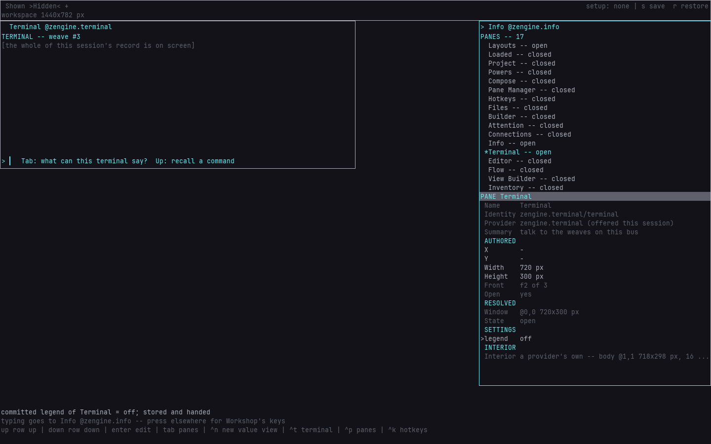
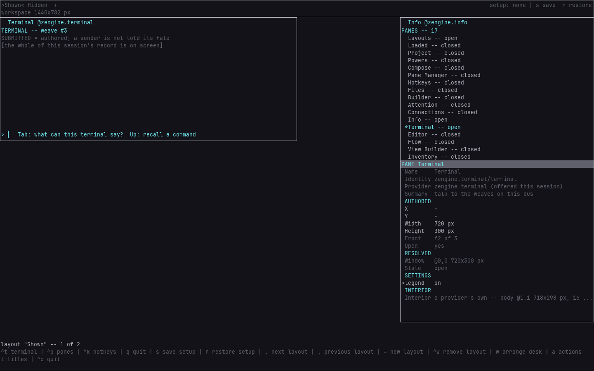
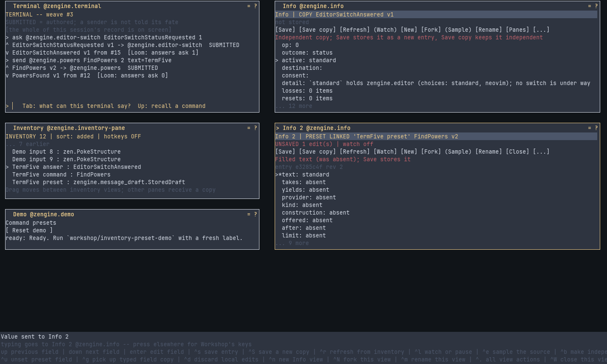
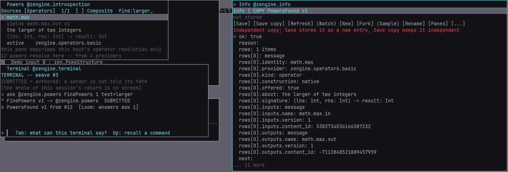

# Terminal

**How-to.** Three things a weaver does with the Terminal and the panes beside it: hiding the
legend in one layout, keeping a command or a reply in Inventory to use again, and finding a power
from the line. What each key does, what the rows say and every refusal are in
[the Terminal's manual](zengine.terminal.md).

## Hiding the legend in one layout

The row under the Terminal's header, `SUBMITTED = authored; a sender is not told its fate`, is the
legend: what the `SUBMITTED` at the end of a line you ran means. Each layout keeps its own choice of
whether it shows: in Info, inspect the Terminal and set `legend` to `off` under `SETTINGS`, and that
layout gives the row to the record while another layout keeps it. A value the legend cannot use
leaves it shown, and the row says why ([`legend`](zengine.terminal.md#legend)).





## Dragging a command or reply into Inventory

Drag a **submitted**, **received**, or **answer** row into Inventory. A wrapped continuation
row names the same item. Inventory stores an independent typed copy and offers a name; Enter
keeps your name, and Escape keeps the generated name. Right-click **Pick up a copy** provides
click-to-place instead. Local command text, notices and completion rows are not payloads.

The copy contains the actual message data with its schema, plus separate historical metadata.
Open it in Info to inspect/edit it, make an incomplete preset, or copy a typed field into Compose.
[Inventory](../../inventory/docs/inventory.md) and [inventory slots](../../inventory/docs/inventory-slots.md) describe those
next actions. Capturing does not execute a command; a later run uses current authority.

Payload history is bounded separately from visible text: up to 64 submitted values and 64
received values. If the item or its transcript entry was evicted, pickup says it is unavailable.
It never substitutes a newer row or reruns the old command to reconstruct it. Copies already
stored in Inventory survive eviction. The carrier accepts envelopes up to 64 KiB; a larger
capture refuses clearly. [Toolbox snapshots](../../inventory/docs/toolboxes.md) keep captured Inventory entries across
restarts; Terminal's own running transcript is separate.

External hands need the `inventory` power both to acquire Terminal values and to add the copy,
and a Workshop whose guests file names it a development host: on a
[weaver's host](../../external-host/docs/external-host.md#whose-host-this-is-and-what-each-power-reaches-there) every key
and press a guest aims at the Terminal is refused.
An old address or authenticated-answer fact in metadata grants no permission to invoke anything.
The original participant retains its command/answer history; the pane never owns that session.

The maintained `workshop/terminal-inventory-demo` tool exercises command and reply capture,
then fills a command preset with a reply field. Start the `presets` demo setup first; see
[the external-host guide](../../external-host/docs/external-host.md). The guest can copy content but cannot borrow
the original Terminal sender's permission to execute it.



## Finding a power

The Terminal may ask the host's
[discovery door](../../introspection/docs/introspection.md#the-discovery-door-finding-a-power) its two
questions — the door Flow's search line and the `Powers` pane ask too, so the same question gets
the same rows here as there:

```text
ask @zengine.powers FindPowers 1 text=larger
ask @zengine.powers DescribePower 1 identity=math.max
```

Every field of `FindPowers` is optional, so you type only what you mean: `text=` finds by name or
by what a power is for, `takes=` and `yields=` by a port's type as the composer spells it (`Int`,
`Text`), and `kind=`, `construction=`, `provider=` and `offered=` narrow the list. The answer is
one page of rows, how many matched in all, and where the next page starts (`after=`).
`DescribePower` answers one power with every contribution standing behind it, the one in force
last. An ask past the door's bounds is answered with a sentence saying which bound, never with
silence. The record names an answer by its shape; to read its rows, drag it into Inventory and
open it in Info ([above](#dragging-a-command-or-reply-into-inventory)).



Asking describes and does nothing else. The Terminal is granted these two asks to the door's office
and nothing more: knowing a power is not leave to send it anything, mount it or open it.
