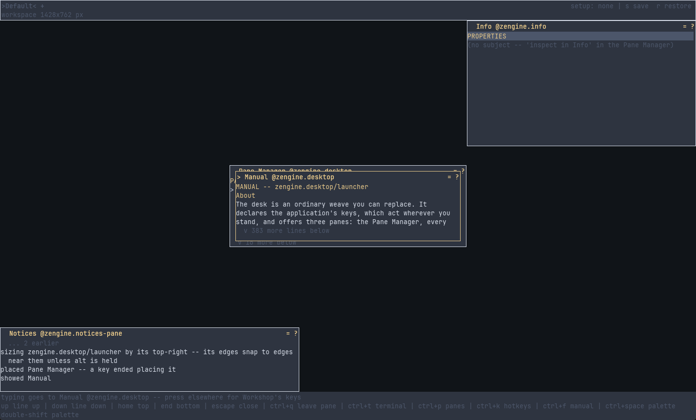

# Workshop

**Workshop is an interactive environment for making things with Zengine: a desk of panes, in a
terminal or a window, where a weaver (a person who writes and runs weaves) edits, builds, loads
and inspects a running program without leaving it.** It is optional: the
[C++ library](../docs/getting-started.md) works without it.

Almost every pane is a tool, a weave Workshop loads. The desk's own Pane Manager, Hotkeys pane
and menus are tools too, and you can change or replace them while Workshop runs.

## Manuals

- [Workshop](docs/zengine.workshop.md), `zengine.workshop`: the pane protocol, shape by shape --
  what a pane, a presenter, a skin or an input producer sends Workshop, and what it answers
- [The desk](docs/zengine.desktop.md), `zengine.desktop`: the keys that act everywhere, the Pane
  Manager, the Hotkeys pane and the Manual, every command by its key
- [The project office](docs/zengine.project.md), `zengine.project`: where the project is, what it
  waits on, whether its plan names an artifact, which file a recipe names; choosing the recipe file,
  adding a recipe to it, and adding a row to the project's load plan
- [The menu presenter](docs/zengine.presenter.md), `zengine.presenter`: how a pane's menu is shown,
  worked and answered
- [The opening office](docs/zengine.opening.md), `zengine.opening`: how a source opens in the Editor
- [The realization owner](docs/zengine.realization.md), `zengine.realization`: the load plan
  performed, and what becomes of a build offered to the running project

## Pages

- [Getting started with Workshop](docs/getting-started.md): launch it and find your way around
- [Panes](docs/panes.md): open, close, move, resize and order panes
- [Hotkeys and the keymap](docs/hotkeys.md): what a key means, and how to change a binding
- [Setups and workspace continuity](docs/setups.md): how your desk is kept and comes back
- [Ready-to-use setups](docs/demo-setups.md): one command prepares a Workshop for a task
- [Choosing what a run is made of](docs/load-plans.md): use and write a load plan
- [Make a Workshop tool](docs/make-a-workshop-tool.md): write a pane of your own
- [Develop Workshop from inside Workshop](docs/develop-workshop.md): edit a shipped pane live
- [Current limitations](docs/limitations.md): what does not work yet
- [The authored load plan](docs/load-plan.md): the load plan file, in full
- [Workshop panes and setups — reference](docs/workshop-panes.md): the contracts that span the
  pane protocol's shapes -- the window, the room, the setup, the canvas, menus and the desk read
- [Pointer spaces — reference](docs/pointer-spaces.md): where a pointer position lands

## What is in this folder

| | |
|---|---|
| `desktop-pane/` | the Pane Manager and the Hotkeys pane: the desk's default behaviour |
| `menu-presenter/` | the tool that shows a pane's menu; you can replace it |
| `default-load-plan.json`, `graphical-load-plan.json`, `skin-load-plan.json`, `sdl-skin-load-plan.json` | the shipped load plans: the terminal window, the OS window, the terminal Skin, the SDL Skin |
| `pane_vocabulary.hpp` and its helpers | the pane protocol a tool speaks, installed: `#include "workshop/pane_vocabulary.hpp"`, linking `zengine::pane` |
| `workshop.cpp` and the rest | the Workshop program |
| `docs/` | these pages |

Working on it: [AGENTS.md](AGENTS.md).
