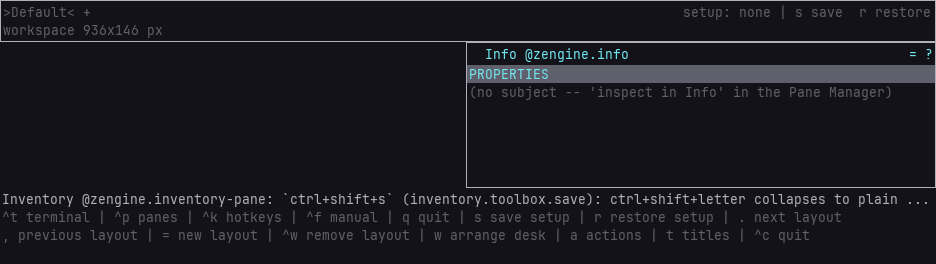
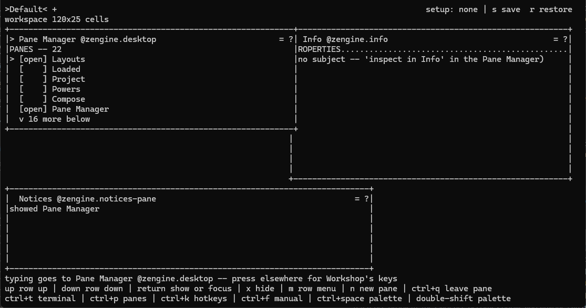
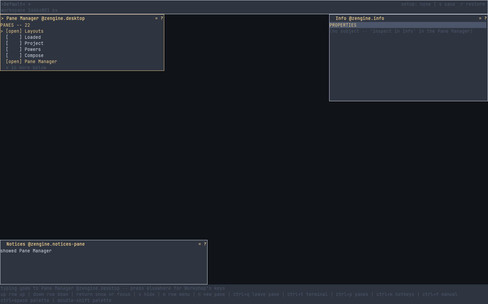

# Getting started with Workshop

Workshop is an interactive environment for making things, built with Zengine. It is optional:
the [C++ library](../../docs/getting-started.md) is usable without it, and nothing here is required to
write a weave.

**What Workshop is today:** a desk of panes over one room. A Terminal pane talks to the live
process, a Builder starts a real build and offers the result to the running project, an
[Editor pane](../../editor/docs/editor.md) opens the file a build recipe names and holds it while you edit, and
Info describes any pane and edits where it sits and how big it is — so `edit → save → build →
realize → inspect` closes without leaving the application. The desk itself — the Pane Manager
that shows, hides and makes panes, the Hotkeys pane, and the keys that work anywhere — is a
tool too, and you can edit, rebuild and replace it while Workshop runs. Your desk comes back on
its own when you relaunch.

**What it is not yet** is written down in [limitations](limitations.md) rather than left to
be discovered — the editor holds one plain-ASCII file at a time, a pane you make yourself is a
view of labels, number fields and buttons ([a view](panes.md#a-pane-of-your-own--a-view)), and a
rebuilt weave whose shape changed needs a prepared replacement rather than a reload.

## Launch it

```sh
build/workshop/zengine-workshop
```

Workshop needs a terminal at least **78 columns by 22 rows**. That is not a preference: at
78x22 every piece of its furniture is exactly on screen with nothing overlapping, and it is
the composition every other size is measured against.

It opens in an OS window where one can open, and in the terminal you started it from where none
can (it says why, once, on the desk). In the terminal by choice:

```sh
build/workshop/zengine-workshop --tui
```

Both are the one shipped plan: its window row loads the OS window, otherwise the terminal window,
and `--tui` takes the terminal window alone. Workshop's own code is identical in both. See
[load plans](load-plans.md#the-window-the-os-window-else-the-terminal-window).

**From a package** ([download and run](../../README.md#download-and-run)), the launchers in its
folder start Workshop for you: `Workshop.cmd` or `./workshop.sh` in a window (in the console or
terminal that ran it where no window can open), `Workshop-terminal.cmd` or
`./workshop-terminal.sh` in that console or terminal (`--tui`). Both start in your project,
`%USERPROFILE%\Zengine` or `~/Zengine`, made at the first start and kept when a newer package
replaces the old one; a `workshop-plan.json` there starts instead of the shipped plan. Each start also writes
`zengine-app.path` there, the package's `zengine-app`, which the apps you export start
([which `zengine-app`](../../app/docs/app.md#which-zengine-app-the-launchers-start)).

### Arguments

| argument | default | is |
|---|---|---|
| `--version` | off | say what this Workshop is — in a package, its version, both commits, the compiler and the build type — and start nothing |
| `--setup <path>` | `workshop-setup.json`, in the directory you launched from | a pane arrangement you named and saved |
| `--session <path>` | `workshop-session.json`, in your **per-user state folder** | the desk, window size and window position you last used — written on close, read on start |
| `--keymap <path>` | `workshop-keymap.json`, in your **per-user config folder** | your hand-edited binding overrides ([hotkeys](hotkeys.md)) |
| `--prefs <path>` | `workshop-prefs.json`, in your **per-user config folder** | presentation preferences Workshop writes when you state one (pane titles, `t`) |
| `--isolated` | off | this run reads and writes **none** of your per-user config or session state but the files named on its command line (`--session`, `--prefs` and the others still win) — for tests, scratch experiments and clean-start diagnosis |
| `--load-plan <path>` | `workshop-plan.json` in the directory you launched from when there is one, else `default-load-plan.json` beside the binary | which artifacts this run is made of |
| `--recipes <path>` | `build-recipes.json` in the directory you launched from when there is one, else `default-build-recipes.json` beside the binary | what this run can build ([the recipe file](../../builder/docs/recipes.md)) |
| `--log <path>` | none | a durable journal of selected facts, appended as they happen; outlives the process |
| `--dump <path>` | none | what the volatile recorder still held when Workshop quit |
| `--document <path>` | `workshop.json` in the project, when there is one | an object document from before the object canvas retired: named once at startup and left exactly as it is |
| `--marks <path>` | `workshop-marks.json`, in your **per-user state folder** | the places you marked in the Files pane ([the marks file](../../files/docs/zengine.files.md#files)) |
| `--guests <path>` | none: no listener | who may connect to this Workshop from another host, and what each may say ([the guests file](../../external-host/docs/zengine.guests.md)) |
| `--read-log <path>` | none | show a journal `--log` wrote, and start nothing ([diagnostics](make-a-workshop-tool.md#find-a-missing-reply-grant)) |
| `--log-refusals` | off | keep refusals in the `--log` journal, which it needs; it grants nothing ([diagnostics](make-a-workshop-tool.md#find-a-missing-reply-grant)) |
| `--demo-history` | off | keep more recent delivery metadata for `--dump` ([diagnostics](make-a-workshop-tool.md#find-a-missing-reply-grant)) |

An empty path is refused by name. `--log` and `--dump` are two different questions: the
journal is what you keep on purpose, the dump is most of a session's story recovered after the
fact. Without either, nothing is written and `q` always leaves a live process.

The **project files** (setup, pane and — once you have written them — plan and recipes) follow
the project: launch from two directories and you have two projects. The three **files of your
own** follow *you*: on Windows the config folder is `%APPDATA%\zengine-workshop` and the state folder
is `%LOCALAPPDATA%\zengine-workshop`; elsewhere they are `$XDG_CONFIG_HOME/zengine-workshop`
(falling back to `~/.config/...`) and `$XDG_STATE_HOME/zengine-workshop` (falling back to
`~/.local/state/...`). An explicit path always wins, `--isolated` wins over the defaults, and
a first launch after upgrading imports any old launch-directory `workshop-keymap.json` /
`workshop-session.json` into those folders **once** — saying so plainly, never deleting the
original, and never overwriting a file already there.

**An old object document is left alone.** Workshop used to open onto a canvas of authored
rectangles kept in `workshop.json`. That canvas retired; your desks, layouts and saved
arrangements did not. If the project still holds a `workshop.json` (or you name one with
`--document`), Workshop says so once at startup and leaves the file exactly as it is — it is
never read as anything else, moved or deleted.

### What it prints before it draws

Workshop prints a few lines of plain scrollback on the way up, and each is a fact you are
entitled to before you press anything:

```text
zengine-workshop - containment: in-process; trusted; no OS sandbox (out-of-process isolation is the isolation host's job)
zengine-workshop - document: retired with the object canvas
zengine-workshop - setup: workshop-setup.json
zengine-workshop - project: /home/you/my-thing
zengine-workshop - last session: C:/Users/you/AppData/Local/zengine-workshop/workshop-session.json (restored at startup, written on quit)
zengine-workshop - keymap: C:/Users/you/AppData/Roaming/zengine-workshop/workshop-keymap.json
zengine-workshop - prefs: C:/Users/you/AppData/Roaming/zengine-workshop/workshop-prefs.json
zengine-workshop - load plan: .../default-load-plan.json
zengine-workshop - load plan: 16 artifact(s) declared
zengine-workshop - log: nothing durable (--log <path> to keep one)
zengine-workshop - terminal: weave #3 (presented by the Terminal pane)
zengine-workshop - build recipes: .../default-build-recipes.json (1)
zengine-workshop - builder: weave #5 holds 1 recipe(s) (open its pane from the Pane Manager)
zengine-workshop - build runner: weave #4 builds with `/usr/bin/cmake`
zengine-workshop - recipe: snake-world-v2 -> .../snake-world-v2.so
```

- **what this host isolates** — `Kernel::containment_note()`, verbatim. An in-process Zengine
  host isolates nothing; read the sentence literally.
- **which files this run is using**, and how many artifacts the plan declared.
- **which project this is** — the directory you launched in. It is what the Files pane
  browses and what a relative source path in a build recipe is relative to.
- **whether anything durable is being kept**, so a session that mattered is not discovered to
  have been unrecorded afterwards.
- **what the Builder will actually run** — the program and its arguments, because a pane cannot
  show you a command before the runner has started it, and what a key in this program will run
  is a fact you are entitled to before you press it.
- **a tool that is not here** — `zengine-workshop - unavailable: ...`, with the refusing layer's
  own sentence, for a pane the plan could not load. Workshop runs without it: see below.

Once the plan has run, Workshop prints the arrangement it made — each artifact `loaded:`, each
tool `unavailable:` — when standard output is not a terminal held by the terminal window. On a
terminal desk those lines would scroll the picture, so the
[`Project` pane](../../introspection/docs/zengine.introspection.md#arrangement) shows the live
arrangement instead.

## The screen

```text
 +---------------------------------------------------------------------+
 | Layouts: >Default< +                                    setup: none |
 +--------------------------------------------+------------------------+
 |                                            |                        |
 |   the room: the panes you open,            |   Info: the one pane   |
 |   stacked here                             |   you inspect, and     |
 |                                            |   the values you open  |
 |                                            |                        |
 +--------------------------------------------+------------------------+
 | notice: what just happened, or a refusal                            |
 | legend: what your keys mean here                                    |
 +---------------------------------------------------------------------+
```

The **room** is the whole screen. Panes are drawn **over** it — none of them sits beside it —
and nothing is drawn where no pane is: the window's own dark ground, or a terminal's. Where
things are is the legend's to say — `Ctrl`+`p` shows the Pane Manager, which lists every pane,
marks a tool that is not in this Workshop `[gone]` and says how to bring it back. Panes cover
the room you are working in. That is uncomfortable on purpose: inventing a docking system before
anybody had felt the discomfort would be answering a demand nobody had made. A wider terminal
splits the surplus evenly between a pane and the room underneath it, so the room always keeps
half.

**Info** is a loadable weave that arrives with its own artifact, not something Workshop
compiles in. Your desk names it, so it is there on a first run, in a fixed place at the right
edge. Every pane in the shipped plan is **optional**: if your build tree is missing
`zengine-info-pane.so`, Workshop still starts, says which artifact it could not load, lists
Info as `[gone]` in the Pane Manager, names it on Workshop's own condition row and keeps the fact
in Attention for the whole run. (While the run is still loading a tool, its row reads `[load]`:
on its way, not missing.) Build
it and launch again. (The host's own infrastructure — the operators, the session history, the
graphics directory and its window, the input weave and the timer — is required, and a plan
missing one of those does not start.)

The **notice** line is where a refusal to what you just did appears. Workshop refuses rather
than clamps: a place or size Info cannot accept leaves the stored one untouched and says why.
It is a report about the gesture you made, and the next thing Workshop says replaces it.

Something that is **still true** when you read it — a settings file that could not be read, a
pane of yours that is off the screen, a tool that could not load — does not go there. It goes
to attention: the **Attention** pane leads with the most serious and how many more, and lists
them all — show it from the Pane Manager. Those disappear when they stop being true and at no
other moment. See [the Attention pane](../../attention/docs/zengine.attention.md).

The **first row** is a pane — [the layout selector](setups.md#several-layouts-in-one-workshop),
called **Layouts**: your layouts as tabs on the left with the one you are on between `>` and
`<`, a `+` that makes another, and — at the row's right-hand edge — what the layout you are on
is related to: `setup: none`, or the Setup file it was saved to or restored from and whether it
still matches it. Being a pane means you can move it, resize it, cover it or hide it, like
Files or the Editor. The **bottom band** is what Workshop just said and what your keys mean
right now: the notice, then the legend rows advertising the current context's gestures. Every
one of those hints is a projection of the effective keymap — remap a binding and the screen
spells the new one — and `Ctrl`+`k` opens the **Hotkeys** pane, the complete list of every key
as it is in force. So the keys are on screen; this page is the fuller version, not the only
source. See [hotkeys and the keymap](hotkeys.md). A pane that comes with a manual wears a `?` at
the right of its title: press it to read what the pane is and every command it has, with your keys
([a pane's manual](panes.md#a-panes-manual-and-its-gear)).

## Your first five minutes

**At your first start, the quick setup asks first**, in front and holding the keys: whether to
edit text with Neovim, and where the ready-to-use setups are. Done or Skip puts it away for good;
find it again in the Pane Manager as Quick setup ([its manual](zengine.first-run.md)).

**A fresh Workshop opens onto your desk**: the Layouts row, Info at the right, and the room.
The Layouts row says `>Default< +` beside `setup: none` — the one layout you have, marked as the
one you are on, related to no Setup file yet. `none` is not a warning: Workshop remembers that
layout for you either way. Nothing is painted behind the panes, and the band's first row says
how to open one: `ctrl+t terminal | ctrl+p panes | ctrl+k hotkeys`.



1. **<!-- key desktop.panes -->`ctrl+p`<!-- /key -->** — the **Pane Manager**: every pane there is,
   open or not. `↑` `↓` choose, `Enter` shows one and puts you in it — a pane that is already
   shown is simply where you land. **`x`** hides one: it leaves the layout, and its tool keeps
   running and keeps what it holds, so `Enter` shows it again as it was. `Ctrl`+`p` works while
   you are typing in another pane.
   See [panes](panes.md#showing-going-to-and-hiding--the-pane-manager).
2. **<!-- key desktop.terminal -->`ctrl+t`<!-- /key -->** — open the Terminal, or go to it if it is
   already up. `Ctrl`+`p`, `Ctrl`+`t` and `Ctrl`+`k` come from the **desktop**, a tool you can
   edit and rebuild like any other, so you can move them, switch them off, or change what they do — see
   [hotkeys](hotkeys.md#keys-the-application-supplies--and-how-to-take-them-away).
3. **Inspect a pane in Info**: in the Pane Manager choose its row, press **`m`** for the row's
   menu and choose **`inspect in Info`**. Info's rows say what the pane is, what you authored for
   it (`X` `Y` `Width` `Height`, each `-` until you say something) and what this screen makes of
   that. **Press into Info**, then **`↑` `↓`** step through those rows; **`Enter`** on `X` `Y`
   `Width` or `Height` opens a draft. Type a whole number in the face's
   unit (cells in a terminal, pixels in a window), then `Enter` to write it or `Esc` to
   abandon; `-` gives the axis back to Workshop's default. A pane's keys reach it only while it
   holds the keyboard — press somewhere else and `↑` `↓` are Workshop's again.
   - Try an illegal value. The refusal names what is wrong, your text stays in the draft, and
     the pane does not move.
   - **The subject stays until you choose another.** Pressing another pane, `Esc`, a press on
     the room — none of them moves what Info is inspecting. Info may inspect itself.
   - **You see where you are typing.** The draft shows its caret and what you have selected —
     a bar between characters in a window, an inverted, underlined cell in a terminal — and a
     long value scrolls to keep the caret in view.
   - **One write at a time.** `Enter` sends the value; `Enter` again before Workshop answers
     sends nothing (`commit not sent`), and your text waits for the next `Enter`. If the layout
     underneath changed before the write arrived, it is refused rather than landing on the
     wrong pane, and nothing is written. A write that never reached Workshop says so
     (`commit not submitted`, `commit not delivered`); your draft and its text stay, and
     `Enter` sends them again.
4. **<!-- key workshop.manage -->`w`<!-- /key -->** — arrange the desk: every pane wears handles.
   Drag a body to move it, an edge or corner to resize it; `Tab` steps between panes, the arrows
   move one cell, `Shift`+arrows resize, and **<!-- key manage.grow -->`=`<!-- /key -->** grows the
   pane by the coarse step at once. `Esc` leaves. See
   [arranging](panes.md#moving-resizing-and-ordering--arrange).
5. **Right-click** a pane, a layout tab or the empty room — Workshop lists what can be done
   with the thing you pointed at, without selecting it. `Enter` chooses, `Esc` closes, and
   **<!-- key workshop.context -->`a`<!-- /key -->** opens the room's menu from the keyboard. See
   [the context menu](panes.md#the-context-menu--what-can-i-do-with-this).
6. **<!-- key setup.name -->`s`<!-- /key -->** — save the layout you are on to the setup file;
   **<!-- key setup.restore -->`r`<!-- /key -->** restores it. **<!-- key layout.new -->`=`<!-- /key -->**
   makes a new layout, **<!-- key layout.next -->`.`<!-- /key -->** and
   **<!-- key layout.previous -->`,`<!-- /key -->** step between them. See [setups](setups.md).
7. **<!-- key workshop.quit -->`q`<!-- /key -->** or **<!-- key workshop.quit -->`ctrl+c`<!-- /key -->** — quit.

> **Your desk comes back.** The panes you had open, where you put them, how big you made them
> and how big the window was are all restored automatically from the last session — no
> keypress. See [workspace continuity](setups.md#workspace-continuity).

## The full key map

[Hotkeys](hotkeys.md#the-default-keys) has it in one place. The short version:

| | |
|---|---|
| anywhere | `Ctrl`+`p` the Pane Manager · `Ctrl`+`t` the Terminal · `Ctrl`+`k` the Hotkeys pane — even inside a pane ([hotkeys](hotkeys.md#keys-the-application-supplies--and-how-to-take-them-away)) |
| the Pane Manager | `↑` `↓` choose · `Enter` show or go to · `x` hide · `n` make a pane of your own in the View Builder ([a view](panes.md#a-pane-of-your-own--a-view)) |
| panes | `Tab` `Shift`+`Tab` and the arrows select a pane · `Enter` gives it your keys · `w` arrange desk · `t` pane titles · `Esc` put the selected pane down · `Ctrl`+`f` the manual of the pane holding your keys, or its `?` ([a pane's manual](panes.md#a-panes-manual-and-its-gear)) |
| anything | right-click, or `a` — what can I do with this ([context menu](panes.md#the-context-menu--what-can-i-do-with-this)) |
| layouts | `s` save · `r` restore · `=` new · `.` `,` next / previous · `Ctrl`+`w` remove ([setups](setups.md)) — the **last** session needs neither |
| quit | `q` · `Ctrl`+`c` where nothing takes text |
| in a pane | its own rows, while it holds the keyboard — press into it, or select it and `Enter`, first: **Info**'s `↑` `↓` `Enter`, the [Builder](../../builder/docs/zengine.builder-pane.md)'s `b` `c` `f` `o`, the [browser](../../files/README.md)'s `u` `m` `a`, [Attention](../../attention/README.md)'s `↑` `↓` `d`, the [Terminal](../../terminal/README.md)'s `Enter` `Tab` `↑` `↓` `Esc` and `Ctrl`+`↑` `Ctrl`+`↓` `Ctrl`+`Home` `Ctrl`+`End` |
| leaving a pane | `Esc`: the pane first lets go of what you chose in it (a row in Loaded or Powers), Compose leaves its form and the [Terminal](../../terminal/README.md) sheds its list and its line; the next `Esc` puts the pane down. Or a press elsewhere, or `Ctrl`+`q`, which leaves any pane or mode and keeps the pane selected. Both editors keep every `Esc`; `Ctrl`+`q` or a press elsewhere is the way out of those |

These are the defaults; every binding can be remapped through the keymap file, and the
on-screen hints and the Hotkeys pane always spell the effective one ([hotkeys](hotkeys.md)).
Keys are read from the Input weave like any other Zengine application's — Workshop holds no
privilege the [snake example](../../examples/snake/README.md) does not.

## Terminal and window differences

| | terminal window | OS window |
|---|---|---|
| how much room | the whole terminal; a redirected or captured run, whose terminal cannot be measured, lays the desk out in the room the restored session names, else the 78x22 minimum, and its picture holds that room | the window's own size, and the person may resize it |
| text in a bounded region | one row per cell row, cut at the region's width | one row per line of the window's face, a character every advance of it, cut at the region's width |
| colour | each area painted by its skin's painter, the role's ink on the terminal | each area painted by its skin's painter, RGB per role |
| what needs attention | the Attention pane, where you put it | the Attention pane, where you put it |





Neither is a degraded version of the other, and the same published intent produces both.

## Next

- [Attention](../../attention/docs/zengine.attention.md) — what is true right now, the pane that lists it, and why hiding
  one is not fixing it.
- [Panes](panes.md) — the Pane Manager, arranging, how to get a bigger one, Info as a pane's
  inspector, and a pane of your own: a view, made in the View Builder.
- [Setups](setups.md) — saving an arrangement, and what does not come back.
- [Load plans](load-plans.md) — choosing what a run is made of.
- [Builder](../../builder/docs/zengine.builder-pane.md) — what it builds today.
- [The source editor](../../editor/docs/editor.md) — edit the file a recipe names, without leaving.
- [Edit a running pane](../../builder/docs/edit-a-running-pane.md), and [develop Workshop](develop-workshop.md) —
  change a pane while it runs: one of your own, or one Workshop ships, the desktop included.
- [Introspection](../../introspection/docs/zengine.introspection.md) — `Loaded`, `Project`, `Powers`.
- [Limitations](limitations.md) — read this before planning around Workshop.
- [Making a Workshop tool](make-a-workshop-tool.md) — if you want to add a pane.
