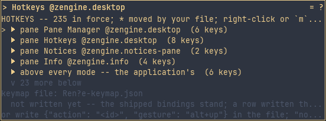
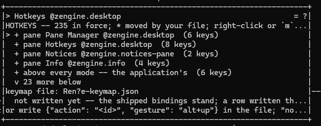

# Hotkeys and the keymap

**Workshop as a product.** What a key means, how to find out without leaving the screen, and
how to change a binding durably. The default bindings are listed
[below](#the-default-keys), each in the place it is answered; the rest of this page is the
machinery that keeps every listed key true.

## One binding truth

Workshop keeps one table of **actions** — a stable identity like `workshop.manage` or
`layout.new`, a label, the context it is available in, and a default gesture. Panes add their
own rows beside it — the Builder's `builder.build`, the Pane Manager's `launcher.close` — and
the desktop adds the keys that work anywhere. Dispatch resolves your keystroke against that one
map, and every place a gesture is written on screen — the bottom band, each mode's heading, the
notices, the Hotkeys pane — is a projection of it. There is no second list to drift: remap a
binding and the screen spells the new one everywhere, because nothing else has a spelling of
its own.

A binding matches its modifiers **exactly**. `w` arranges the desk; `Ctrl`+`w` is a different
gesture, and removes the layout you are on. Where one family is deliberately spelled two ways —
move and resize on the arrows and `Shift`+arrows while arranging, build and load-after-build on
`b` and `Shift`+`b` in the Builder — those are separate actions with separate bindings, each
remappable on its own.

A remap changes how an action is **requested**, never what it may do or who performs it. The
keymap holds names and gestures only; the operations stay with their owners.

## Keys the application supplies — and how to take them away

Some keys are not Workshop's at all. **Which tool a chord opens, and what a key means where
nothing more specific claimed it, belong to the desktop** — a tool that arrives by a row in your
load plan like every other, and that you can edit, rebuild or replace. Out of the box it supplies
these:

| key | what it does |
|---|---|
| <!-- key desktop.panes -->`ctrl+p`<!-- /key --> | show or hide the **Pane Manager**: it shows with your keys in it, and a second press hides it ([panes](panes.md#showing-going-to-and-hiding--the-pane-manager)) |
| <!-- key desktop.terminal -->`ctrl+t`<!-- /key --> | open the **Terminal**, or put you in it |
| <!-- key desktop.hotkeys -->`ctrl+k`<!-- /key --> | open the **Hotkeys** pane, or put you in it |
| <!-- key desktop.manual -->`ctrl+f`<!-- /key --> | show the manual of the pane you are in, as its `?` does ([a pane's manual](panes.md#a-panes-manual-and-its-gear)) |
| <!-- key desktop.palette -->`ctrl+space`<!-- /key -->, or <!-- key desktop.palette-shift -->`double-shift`<!-- /key --> | show or hide the **command palette** ([its manual](zengine.palette.md)) |
| <!-- key desktop.deselect -->`escape`<!-- /key --> | put down the pane you have selected, where nothing more specific wanted the key |

All but the last are answered **above every mode**: they work while your hands are in a pane,
which is the whole point of a key that opens a tool. A pane that must own one of them says so by
name, and then the chord is the pane's for as long as that pane has the keyboard — that is a
declaration, not a guess, so it survives you moving either key.

`Esc` is answered **last**, exactly where it always was: every mode, draft and focused pane
answers its own `Esc` first, and only a press nothing claimed puts the selected pane down.
Neovim's `Esc` is still Neovim's.

**Remap them like any other key**, by id — `desktop.panes`, `desktop.terminal`,
`desktop.hotkeys`, `desktop.manual`, `desktop.palette`, `desktop.palette-shift`,
`desktop.deselect` — and **switch one off** by binding it to `none`:

```json
{ "action": "desktop.deselect", "gesture": "none" }
```

The row stays in the Hotkeys pane with no key beside it, and nothing takes over for it. There is
no second copy of the behaviour inside Workshop waiting to answer — which is what makes these
defaults genuinely yours. If you ever want a different set, change the desktop's own source
(`workshop/desktop-pane/pane.cpp`) and rebuild it: everything on this list is declared there, and so are
the Pane Manager's and the Hotkeys pane's own keys.

**The old names still work.** A keymap file written when these were Workshop's own —
`workshop.terminal`, `workshop.hotkeys` — is read as `desktop.terminal` and `desktop.hotkeys`,
and the load says so once, naming the rename to make. The file is not rewritten.

**A Workshop with no desktop still runs.** If that row of your load plan cannot be loaded,
Workshop's own condition row names it for the whole run — `zengine-desktop-pane is not in this
Workshop` — the empty room is blank, and you have no application defaults and no Pane Manager
until you build it and launch again. Workshop's own keys (`w`, `a`, the layout keys, `q`) still
work. A graphical launch also prints the refusal on its console; in a terminal Workshop the
terminal window owns the terminal by then, so the condition row is where it is said.

## The default keys

What each key does out of the box, in the place it is answered, with the id a keymap file names it
by ([the keymap file](#the-keymap-file)). The Hotkeys pane shows the keys in force, yours
included. The desktop's keys are [above](#keys-the-application-supplies--and-how-to-take-them-away);
these are Workshop's own.

**Anywhere**, even while a pane takes your text: <!-- key focus.leave -->`ctrl+q`<!-- /key -->
(`focus.leave`) leaves the pane or mode you are in and keeps the pane selected;
<!-- key workshop.quit -->`ctrl+c`<!-- /key --> (`workshop.quit`) quits where nothing takes text,
and in a line that does, it copies.

**Command mode**, where no pane holds your keys:

| key | id | does |
|---|---|---|
| <!-- key workshop.context -->`a`<!-- /key --> | `workshop.context` | the context menu for the room ([the context menu](panes.md#the-context-menu--what-can-i-do-with-this)) |
| <!-- key workshop.manage -->`w`<!-- /key --> | `workshop.manage` | arrange the desk ([arrange](panes.md#moving-resizing-and-ordering--arrange)) |
| <!-- key workshop.pane-titles -->`t`<!-- /key --> | `workshop.pane-titles` | show or hide pane titles ([pane titles](panes.md#pane-titles)) |
| <!-- key setup.name -->`s`<!-- /key --> / <!-- key setup.restore -->`r`<!-- /key --> | `setup.name` / `setup.restore` | save the layout you are on to its setup file / restore it ([setups](setups.md)) |
| <!-- key layout.next -->`.`<!-- /key --> / <!-- key layout.previous -->`,`<!-- /key --> | `layout.next` / `layout.previous` | the next / previous layout |
| <!-- key layout.new -->`=`<!-- /key --> | `layout.new` | a new layout, holding the desk a fresh Workshop opens on |
| <!-- key layout.remove -->`ctrl+w`<!-- /key --> | `layout.remove` | remove the layout you are on |
| <!-- key focus.next -->`tab`<!-- /key --> / <!-- key focus.previous -->`shift+tab`<!-- /key --> | `focus.next` / `focus.previous` | select the next / previous pane |
| <!-- key focus.left -->`left`<!-- /key --> <!-- key focus.right -->`right`<!-- /key --> <!-- key focus.up -->`up`<!-- /key --> <!-- key focus.down -->`down`<!-- /key --> | `focus.left` and the rest | select the pane on that side |
| <!-- key focus.enter -->`return`<!-- /key --> | `focus.enter` | give the selected pane your keys |
| <!-- key workshop.quit -->`q`<!-- /key --> | `workshop.quit` | quit |

No key asks for these until your file binds one: `layout.rename`, `layout.duplicate`,
`layout.move-left` and `layout.move-right`, on a tab's menu; `pane.edit-code`, on a pane's menu;
`workshop.band-keys` and `workshop.hotkeys-keys`, in a pane's Settings
([how keys are spelled](#how-keys-are-spelled)).

**Arranging**, the desk (<!-- key workshop.manage -->`w`<!-- /key -->) or one pane (its menu's
`arrange`), the same keys in both ([arrange](panes.md#moving-resizing-and-ordering--arrange)):

| key | id | does |
|---|---|---|
| <!-- key manage.place-left -->`left`<!-- /key --> <!-- key manage.place-right -->`right`<!-- /key --> <!-- key manage.place-up -->`up`<!-- /key --> <!-- key manage.place-down -->`down`<!-- /key --> | `manage.place-left` and the rest | move the pane one cell |
| <!-- key manage.pull-left -->`shift+left`<!-- /key --> <!-- key manage.pull-right -->`shift+right`<!-- /key --> <!-- key manage.pull-up -->`shift+up`<!-- /key --> <!-- key manage.pull-down -->`shift+down`<!-- /key --> | `manage.pull-left` and the rest | resize it one cell, its top-left corner staying put |
| <!-- key manage.grow -->`=`<!-- /key --> / <!-- key manage.shrink -->`-`<!-- /key --> | `manage.grow` / `manage.shrink` | grow / shrink it by the coarse step on both axes |
| <!-- key manage.front -->`f`<!-- /key --> / <!-- key manage.back -->`b`<!-- /key --> | `manage.front` / `manage.back` | send it to the front / back |
| <!-- key manage.raise -->`r`<!-- /key --> / <!-- key manage.lower -->`l`<!-- /key --> | `manage.raise` / `manage.lower` | raise / lower it one step |
| <!-- key manage.remove -->`d`<!-- /key --> | `manage.remove` | take it off the layout; the Pane Manager brings it back |
| <!-- key manage.reset -->`0`<!-- /key --> | `manage.reset` | reset: then <!-- key manage.reset-place -->`p`<!-- /key --> place, <!-- key manage.reset-width -->`w`<!-- /key --> width, <!-- key manage.reset-height -->`h`<!-- /key --> height, <!-- key manage.reset-order -->`o`<!-- /key --> order, <!-- key manage.done -->`escape`<!-- /key --> back |
| <!-- key manage.close -->`escape`<!-- /key --> | `manage.close` | leave |
| <!-- key manage.next -->`tab`<!-- /key --> / <!-- key manage.previous -->`shift+tab`<!-- /key --> | `manage.next` / `manage.previous` | the desk only: step the keyboard to the next / previous pane |
| <!-- key manage.arrange -->`return`<!-- /key --> | `manage.arrange` | the desk only: arrange exactly that pane |

**The context menu**: <!-- key context.up -->`up`<!-- /key --> and
<!-- key context.down -->`down`<!-- /key --> choose a row, <!-- key context.choose -->`return`<!-- /key -->
chooses it, <!-- key context.back -->`escape`<!-- /key --> backs out. **Renaming a layout**:
<!-- key naming.commit -->`return`<!-- /key --> renames it, <!-- key naming.cancel -->`escape`<!-- /key -->
leaves the name as it was.

**A pane's own keys** are in its manual, which <!-- key desktop.manual -->`ctrl+f`<!-- /key --> shows
for the pane you are in; each folder's front page lists its manuals ([the map](../../docs/README.md#the-map)).

## The Hotkeys pane — `Ctrl`+`k`

`Ctrl`+`k` opens the **Hotkeys** pane, or puts you in it ([its commands](zengine.desktop.md#commands-in-the-hotkeys-table)): the desktop's list of every key as it
is **in force right now**, in a section for each place a key is answered -- each pane that declared
rows, the keys above every mode, command mode, the arranging scopes, the contextual menu, the name
line. The panes on your desk come first, Workshop's own places next, and the panes not on your desk
last, in grey. Every section is shut at first, its header saying how many keys it holds; open one
with `→` or a click on its header, shut it with `←`, and shut them all with `Shift`+`←`. Under an
open section's header stands each row: the key, spelled as your keymap file spells it unless you
chose the short spelling ([how keys are spelled](#how-keys-are-spelled)), what it does, and the id
a file names it by. A `*` marks a key your own file moved or switched off. In the window, and in a
Windows console, resting the pointer on a shut section's header shows its keys over the rows below
until the pointer moves away. Which sections are open lasts while the desktop is reloaded.
Beneath the list it names the keymap file this run reads and what reading it came to; a character
the pane cannot draw there -- an `é` in your profile's folder, say -- is shown as `?`.
`↑` `↓` `Home` `End` scroll it.





It is an ordinary pane: arrange it, cover it, hide it, and `Ctrl`+`k` brings it back. It is not
a mode — reading it takes no keyboard away from anything, and every key it lists works while it
is open. What it shows is what Workshop tells it: the effective keymap, re-told whenever your
file, a pane's declaration, the desktop's own rows or an edit change it. It is a table — the key
in the spelling you chose for it, the label, the id, and `*` for a row your file moved — with a row
cursor over the sections' headers and the open sections' keys: `↑` `↓` walk it, `Home` `End` jump,
the wheel walks it too, and a click chooses a row.
An action with several keys is listed once per key. Inside any text field, the text
box's own editing keys — copy, cut, paste, select, word movement, undo — are shown for discovery
but are **not remappable**: they belong to the editing component, in every box at once, and the
keymap does not reach into it. A loaded pane's vocabulary beyond its declared rows is the
pane's own, and the list says so rather than guessing.

## Editing a binding

**Right-click a row** of the Hotkeys pane — or put the cursor on it and press **`m`** — and a
small menu opens beside it:

| row | does |
|---|---|
| `Modify (press a key)` | the next key you press becomes the action's only key |
| `Modify (type a spelling)` | type the key as the file spells it (`alt+up`, `shift+h`, `[`), then `Enter`; a spelling is plain ASCII on one line, so text typed or pasted holding anything else is not typed, and the pane says so |
| `Add a key (press)` / `Add a key (type)` | the action keeps its keys and gains this one |
| `` Remove `key` `` | this row's key stops requesting the action; removing the last one **disables** it, and the notice says so — nothing falls back to the default you just removed |
| `Disable` | no key requests the action (the file says `none`) |
| `Reset to default` | every row you authored for it leaves the file; the declared default stands |

Choosing an edit row takes the keyboard for the capture or the spelling even when another pane
had it — the choice asks for the keys on its own terms, whether you chose with the keys or with a
click (its release is part of the same click). A key or a click you make before the edit begins
is newer than the choice, and the keys stay where it put them. The menu itself is shown by the
menu presenter ([panes](panes.md#replacing-the-menu-presenter)); another presenter shows the
same rows its own way and the edits do not change.

Press a key, and the change is **live at once** — the band's legend and the table both say the
new key — **and written to your keymap file** in the same breath. Workshop's notice, in the
Notices pane, says both facts, or which of them did not happen. While a key is being captured, only `Esc`
is a key of the pane's; every other key is the one you meant. A chord that opens a tool above
every mode — `Ctrl`+`p`, `Ctrl`+`t`, `Ctrl`+`k` — cannot be captured, because it does what it
does before the pane sees it: type its spelling instead. A modifier pressed alone is refused as
not a key this keymap can name; press the whole chord, or type it. The one exception is
`double-shift`, Shift tapped twice alone and quickly, which Workshop reads per hand from Shift's
presses and the release between them; it takes no modifier, a terminal cannot report it, and you
type it, as Shift alone cannot be captured.

**What is refused, and why nothing changes.** An edit is judged exactly as your file is judged at
launch: the whole map — Workshop's rows, the desktop's, and every pane's rows in force — with
your change in it. A key already answering to another action in a context that can be active at
the same time is refused in the collision law's own sentence, naming both actions; a spelling
outside the grammar is refused naming what would have worked; and a refusal changes nothing —
not the live map, not the file, not any pane's rows. A pane declaring its rows later is judged on
its own, as it always was.

**The file, after an edit.** The file holds your rows as values, in the order they were
authored; a row for an action this build does not know, or one that retired, is kept exactly.
The layout — key order, whitespace — is the writer's own, not the one you typed, so keep a
hand-edited file's comments elsewhere (there are none in JSON to lose). The file is written as
**format version 2**, which allows an action on several rows; a file written by an earlier
Workshop (version 1) is read as it is and becomes version 2 at your first edit, and an earlier
Workshop refuses a version-2 file by its number rather than misreading it.

**When the change is live but not written**, the notice says so and a standing condition names
it, because the next launch will not have it:

- `--isolated` runs have no keymap file;
- a file that was **refused at launch** refuses every edit, until you fix it and launch again —
  Workshop never writes over a file you have not repaired;
- a file **changed by another hand since this Workshop read it** is not overwritten; relaunch to
  read it, then edit again;
- a write that fails says the writer's reason.

## The band legend

The bottom band carries the same projection on its legend rows — three rows in a terminal, one
row of real type in a graphical window, however many the band's room genuinely holds of the
medium's own text — in three persisted modes, the `legend`
word in the keymap file:

| word | the legend rows show |
|---|---|
| `full` (and `default`) | the current context's bindings, packed as room permits, cut with a mark |
| `compact` | only the desktop's keys answered above every mode, beginning `ctrl+t terminal \| ctrl+p panes \| ctrl+k hotkeys` |
| `hidden` | nothing |

`hidden` blanks the legend rows and does nothing else. Every other row — the notice beside
them, and the Layouts row a whole band away — never moves with the preference, the screen keeps
its shape, and no binding is unbound by choosing not to look at the legend. Where the packed
rows cannot carry every pair, the cut is marked and the Hotkeys pane remains the complete list,
one keystroke away in every mode.

## How keys are spelled

One key can be written two ways. **Full** is how a keymap file writes it: `shift+b`, `ctrl+p`,
`return`. **Short** is the band's compact voice: `B` for Shift and `b`, `^p` for Ctrl and `p`,
`enter`. You choose, apart, how two places write keys:

| setting | where it shows | starts as |
|---|---|---|
| **band key spelling** | the band, and every hint and notice Workshop writes on the screen | full |
| **Hotkeys key spelling** | the Hotkeys pane, and a pane's manual (its `?`) | full |

Both are in the **Settings** a pane's gear opens ([Panes](panes.md#a-panes-manual-and-its-gear)),
and you can bind a key to either in your keymap file (`workshop.band-keys`,
`workshop.hotkeys-keys`). Choosing one switches that spelling and says so; changing one never changes the other. Each is saved with your
preferences, beside pane titles, and comes back the next time you start Workshop. A spelling only
changes how a key is written down: what a key does, your keymap file, and how you write a key in
that file are all unchanged.

## The keymap file

Overrides live in one JSON file, `workshop-keymap.json` in your per-user config
folder by default — `%APPDATA%\zengine-workshop` on Windows, `$XDG_CONFIG_HOME/zengine-workshop`
(else `~/.config/zengine-workshop`) elsewhere — so your bindings follow *you* rather than the
directory you launched from (`--keymap <path>` chooses another file; `--isolated` reads none).
The defaults live in the program; the file carries only your differences, written by the
Hotkeys pane's edits or by your hand:

```json
{"zen":1,"schema":"WorkshopKeymap","version":2,"fields":{
  "format":"zengine-workshop-keymap","format_version":"2",
  "legend":"default",
  "overrides":[
    {"action":"desktop.terminal","gesture":"alt+up"},
    {"action":"layout.new","gesture":"n"},
    {"action":"layout.next","gesture":"."},
    {"action":"layout.next","gesture":"ctrl+n"}
  ]}}
```

It is Zen's JSON text, as Workshop writes it: the envelope's `zen` and `version` are numbers, and
inside `fields` a whole number such as `format_version` is written as a string.

**One action, several keys.** An action written on several rows answers to every one of them;
the legend spells the first, and the Hotkeys pane lists them all. The same key twice for one
action, or `none` beside a key, is refused.

A gesture is modifier words joined to one key name with `+`: `ctrl+k`, `shift+h`, `[`, `]`.
Modifiers are `ctrl`, `shift`, `alt`, `super`; key names are the letters and digits, the
punctuation keys by their own character, and `return`, `escape`, `backspace`, `tab`, `space`,
`home`, `end`, `delete`, `left`, `right`, `up`, `down`. Nothing else is a binding: there are
no sequences, no leader keys and no macros.

The file is read once at startup and answered in words. A file that **applied** says so in the
Notices pane, with the override count — that happened, once, at this launch. A file that was
**refused** is a standing condition instead: the defaults stand for the whole run and for
every run until you change the file, so it goes to attention with the loader's own reason and
stays there until it is no longer true ([the Attention pane](../../attention/docs/zengine.attention.md)). Workshop
never trims or "fixes" it; what writes it is an edit an office asked for -- the Hotkeys pane's,
when you change a binding there -- judged whole and applied before it is written, and an edit
never touches a file that was refused or that changed under it
([editing a binding](#editing-a-binding)).

The file and its folder may be named in any language. Below, Workshop was launched with its
per-user folders, and the file its `--keymap` names, in a folder named `Zoë Ж`, then quit and
launched again: the desk, the hidden titles and the keymap came back from there. The keymap gives
the Pane Manager `alt+up` beside `ctrl+p`; Workshop's notice in the Notices pane and the Hotkeys
pane both spell what they cannot draw as `?`.


**What is refused, by name:**

- a gesture outside the grammar, naming what was found and what would have worked;
- the same key authored twice for one action, or `none` beside a key for one action;
- two actions holding one gesture in contexts that can be active together — the refusal names
  both actions and the contested gesture, because a lockout must not be savable. Reusing a
  gesture across contexts that cannot coexist is fine, and the defaults already do it (`w`
  opens the desk arrangement in command mode and resets a width inside the reset prompt);
- a **bare printable** on an always-available action: once anything on screen can take text,
  a bare letter cannot be global — it would be stolen from every field you type into;
- an editing chord (`ctrl+c`, `ctrl+v`, …) on an always-available action: every text field
  would consume it first, so the binding could not mean what it says where it matters most.

An action that is available only **where nothing is taking text** is a different class and is
allowed an editing chord, because in that class no text field is listening: that is exactly
how `Ctrl`+`c` quits from command mode and copies inside a field. (The object document's
`Ctrl`+`s` and `Ctrl`+`o` and the old attention view's `Ctrl`+`a` were the other members of this
class, and retired with what they opened. The Editor's `Ctrl`+`s` is its own `save source` row,
and the Neovim-backed Editor's `Ctrl`+`o` is Neovim's own jump back —
[Neovim in Workshop](../../editor/docs/neovim.md).)

**A pane's own rows are judged later, too.** A pane declares its rows when it arrives and may
declare them again while it runs — Files does whenever its chooser or recipe line opens, and the
Hotkeys pane does while it captures a key or takes a spelling. Each declaration meets your file
under the same collision law, and one that collides is refused: Workshop names the pane and both
actions on its band and keeps the rows it last accepted from that pane, so it goes on naming keys
by those rows.
Nothing is sent to the pane, which carries on in its new step, where those names may mean
nothing. [Files](../../files/docs/zengine.files.md#use) says what that means for its chooser and recipe line
today, and how to recover.

**What is kept:** an override whose action id this build does not know is preserved exactly
as you wrote it — byte for byte, in place — not deleted and not an error. It is your intent,
addressed to whichever build understands it. An id for an action that **retired** — the
`p` picker's `workshop.picker` and `picker.*`, the old Pane Manager's `pane-editor.*` and
`draft.*`, the object canvas's `object.*` — is kept the same way, answered by nothing, and the
load says what it retired with and where the act went now (`desktop.panes` shows and hides
panes; arranging a pane orders it; Info's own rows commit and cancel its edits). The View
Builder's ids are `view.*` and Info's value views' are `info.value.*`, so an override naming the
bare `save`, `open`, `new` or `choices`, or an `inventory.*` id the Inventory pane does not
declare, is kept as any unknown id is and answered by nothing; one naming `run`, `apply` or
`stop` moves Flow's rows of those ids, and one naming `inventory.up` or `inventory.down` the
Inventory pane's.

**What is said:** a gesture with a known backend gap is accepted and the gap is named once at load.
The honest example: a plain POSIX terminal reports `shift` only on letters, never on `space` or the
digits; it cannot produce `ctrl+h/i/j/m` distinctly from backspace, tab, newline and return, nor
`ctrl+2` from `ctrl+space`, which send one byte; `ctrl` arrives on the letters, `space` and the
editing keys only; `alt` arrives only on the editing keys and `super` never. A graphical window has
none of these limits. Workshop applies what you authored as you wrote it, in every window, and
tells you which terminals cannot say it.

**A POSIX terminal's keys:** a pane may name a second key for an action whose default a POSIX
terminal cannot deliver. Shown in the terminal window on a system other than Windows, whose keys
come from a POSIX terminal, Workshop puts that key in force in place of the default; everywhere
else the default stands. The band spells the key in force, and the Hotkeys pane shows the default
with the POSIX key beside it, as `ctrl+shift+s  posix alt+end`. A row your file names moves in
every window, and the POSIX key goes with it.

**Resetting** is `Reset to default` on the row in the Hotkeys pane, or deleting the file, or the
rows you regret. An absent file *is* the defaults; nothing is stored anywhere else.

## What this is not

Provider panes keep their own keyboards for everything they did not declare: a focused pane
receives every ordinary key and character uninterpreted, and what those mean is the provider's
to define and to document. What a pane *declares* — its own action ids, such as `powers.view`
— joins this keymap under the same collision law, appears in the legend and the Hotkeys pane,
and moves in the same file, by id, exactly as Workshop's own rows do. The editing component's
keys are shared by every text field and are not per-application. There is a
[command palette](zengine.palette.md), on <!-- key desktop.palette -->`ctrl+space`<!-- /key -->,
which lists every action in force and runs one by name as its key would; on a system whose input
method keeps Ctrl+Space for itself, the key never reaches Workshop, and the palette is opened from
the Pane Manager or by a key you give `desktop.palette`. There is no macro recorder and no
key-sequence grammar — a binding is one named key with the modifiers that were held.
